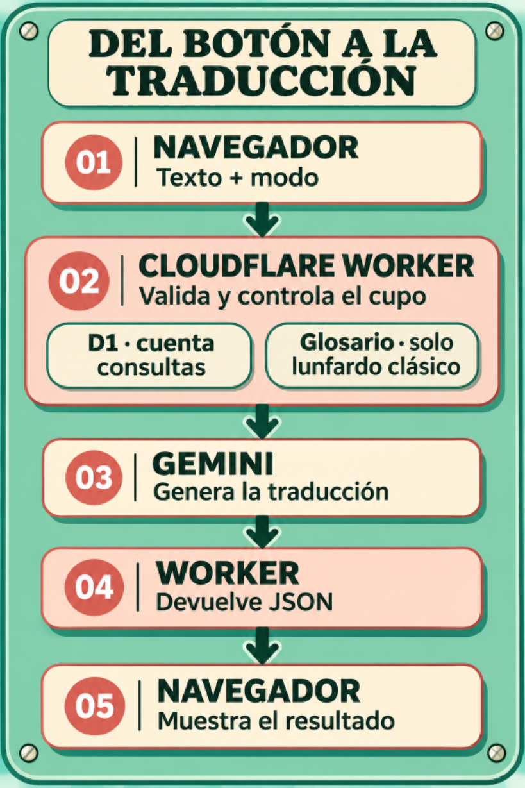

Con el [Traductor LinkedIn](/labs/traductor-linkedin/) ya había probado conectar una página de Hugo con Gemini mediante un Cloudflare Worker. La Máquina de hacer chamuyo funciona prácticamente igual, pero cambia el tema por los argentinismos y el lunfardo. Para que no fuera otro formulario plano, le dimos (ChatGPT y yo) aspecto de aparato retro con HTML, CSS y JavaScript: perillas, luces, agujas y un botón grandote. Además, el modo Lunfardo clásico aporta al modelo referencias de un glosario propio basado en Todo Tango (aunue las traducciones pueden salir medio disparatadas).

<a href="/maquina-de-chamuyo/" target="_blank" rel="noopener noreferrer"><strong>Abrir la Máquina de hacer chamuyo</strong></a>

## Qué hacen los botones

Hay cuatro modos: **argentino cotidiano**, **lunfardo clásico**, **castellano neutro** y **modo exagerado**. El selector giratorio y las opciones iluminadas hacen lo mismo: cambian las instrucciones que después recibirá Gemini. En **Lunfardo clásico**, además de cambiar las instrucciones, el Worker selecciona referencias de un pequeño glosario propio.

Los botones de ejemplo cargan una frase y seleccionan un modo. **Limpiar** borra el texto y vuelve al modo inicial; **Copiar** lleva la traducción al portapapeles. El indicador de **nivel de chamuyo** se mueve según el modo seleccionado, pero es puro decorado: no mide nada. Ninguno de esos controles consume una consulta de IA.

El único botón que manda algo a Internet es **TRADUCIR**.

## Las instrucciones detrás de cada modo

La máquina usa siempre el mismo modelo de Gemini. Lo que cambia al mover el selector es una línea del *prompt* que el Worker manda como instrucción al modelo:

- **Argentino cotidiano:** «Reescribí el texto en español argentino cotidiano contemporáneo».
- **Lunfardo clásico:** «Reescribí el texto usando lunfardo clásico razonablemente documentado, con naturalidad y sin inventar antigüedades. Si la frase no admite una traducción verosímil, conservá parte del español general».
- **Castellano neutro:** «Reescribí el texto en castellano neutro claro, entendible fuera de Argentina. Explicá los argentinismos detectados en el original».
- **Modo exagerado:** «Reescribí el texto con humor argentino, exagerando de forma moderada modismos y lunfardo, sin perder el sentido ni recurrir automáticamente a muletillas o insultos».

Todos los modos comparten instrucciones para conservar el significado, los tiempos verbales, las negaciones y los hechos; evitar traducciones literales de frases hechas y no inventar entradas de diccionario. También se le pide distinguir el lunfardo de otras épocas del habla actual, sin meter un «che», un «boludo» o un «viste» en cada oración por el solo hecho de sonar argentino. El texto ingresado se trata como material para traducir, aunque contenga algo escrito como una orden.

El modo exagerado lleva una *temperatura* de Gemini de `0.8`, frente a `0.35` en los demás. Ese parámetro le da más libertad para variar palabras y expresiones: no mide el nivel de chamuyo ni hace que la traducción sea más precisa.

El Worker le pide a Gemini una respuesta JSON con el texto traducido y algunos datos auxiliares. La máquina muestra únicamente la traducción. Todas las consultas llevan «Argentina en general» como región fija.

## El glosario del modo clásico

Para **Lunfardo clásico**, el Worker incorpora un glosario de **29 términos** elaborado a partir del [diccionario de Todo Tango](https://www.todotango.com/comunidad/lunfardo/). Cada entrada tiene una explicación breve, contrastada con la ficha correspondiente, y conserva el enlace a la fuente. El glosario no copia el diccionario completo ni sus definiciones.

El Worker relaciona la frase recibida con las pistas de ese glosario. Ante «No tengo dinero y hoy no tengo ganas de trabajar», por ejemplo, encuentra *guita*, *vento*, *fiaca* y *laburar*. Agrega hasta seis referencias al prompt y deja que Gemini elija las que encajen. No reemplaza palabras automáticamente: un término puede tener varios sentidos y quedar fuera de lugar según el contexto.

El glosario **solo interviene en Lunfardo clásico**. En los otros modos, Gemini recibe las instrucciones anteriores. Si el texto no coincide con ninguna entrada, el Worker se lo aclara al modelo en lugar de rellenar la traducción con términos elegidos al azar.

Las fichas están guardadas junto al código, no en D1: no hay que consultar Todo Tango por Internet cada vez que alguien aprieta el botón. D1 sigue ocupándose únicamente del contador de consultas. El glosario es pequeño y ampliable; no pretende representar las miles de voces recopiladas en Todo Tango.

## Qué pasa cuando alguien aprieta Traducir

El JavaScript de la página toma la frase, el modo elegido y una región general fija. Envía esos datos como JSON mediante una petición HTTPS al **Cloudflare Worker**. Hugo ya hizo su trabajo al servir la página: no participa en la traducción.

El Worker revisa que la solicitud venga de un origen permitido y que los datos sean válidos. Después consulta una base **Cloudflare D1**, donde llevamos la cuenta de cuántas traducciones se pidieron ese día. Por ahora el límite propio de la máquina es de **20 por día entre todos los visitantes**; no es el límite gratuito que fija Google.

Si todavía hay cupo, y el modo es Lunfardo clásico, el Worker busca coincidencias en el glosario y agrega las referencias encontradas a las instrucciones. Después llama a la **API de Gemini** con la frase y el prompt correspondiente. La clave de la API está guardada como secreto en Cloudflare, así que no aparece en el JavaScript que recibe el navegador.

Gemini devuelve una respuesta estructurada. El Worker toma el texto traducido, lo devuelve como JSON y el JavaScript lo coloca en la pantalla **SALIDA**, junto con el número de consultas que quedan. Si la traducción falla, el Worker intenta devolver esa consulta al cupo.

<figure style="max-width:440px; margin:1.5rem auto; text-align:center;">
  
</figure>

D1 guarda solamente la fecha y la cantidad de consultas. No almacena las frases. El texto sí viaja a Gemini porque justamente le estamos pidiendo que lo procese; mejor no pegar información privada.

## Por qué quedó armado así

La aplicación está hecha con **HTML, CSS y JavaScript** dentro de `static/` de Hugo. El backend es un **Cloudflare Worker** separado. El despliegue se hizo con **Wrangler**; **D1** lleva el contador y **Gemini 3.5 Flash-Lite** genera las respuestas. La clave queda del lado del Worker.

**Todo el código lo generó ChatGPT**: la interfaz, los estilos, el Worker, el glosario y las pruebas. La idea de la máquina, su estética y los ajustes surgieron de nuestras conversaciones. Yo probé la aplicación con Hugo local y ejecuté el despliegue del Worker en Cloudflare.

Durante las pruebas, **Hugo servía la página en `localhost:1313`** y el navegador consultaba directamente el Worker desplegado en Cloudflare. No hizo falta montar otro backend en la PC.

El glosario propio mejora el contexto que recibe Gemini en el modo clásico, pero no garantiza resultados correctos. El modelo sigue escribiendo la traducción y puede pasar por alto una referencia, elegir otra palabra o producir una frase poco convincente. Pero bueno, lo que quería probar era la integración técnica y el diseño de la máquina. Quizá más adelante le dé más bola a las traducciones.
