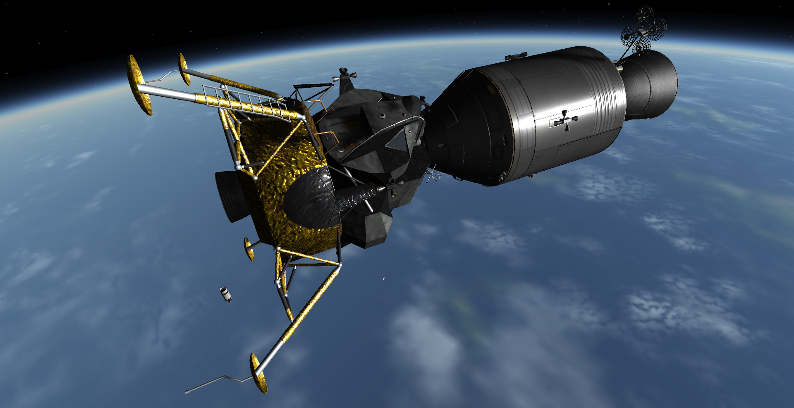
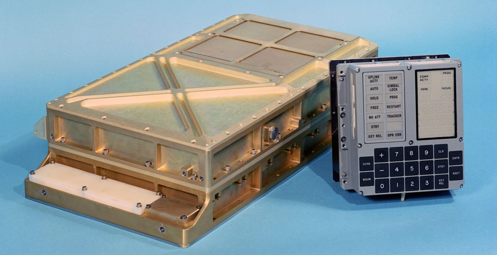
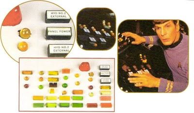
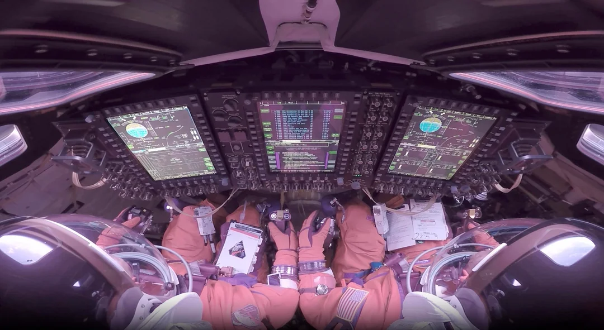

*Texto original: 13/04/2026. Actualización: 23/11/2026 (revisión editorial y estructura).*

Algo que me quedó dando vueltas en la cabeza cuando escribí [la nota sobre los viajes a la Luna](/notas/le-voyage-dans-la-lune/) fue la computadora de vuelo de Apollo, sobre todo la forma en que los astronautas interactuaban con ella mediante una consola numérica y comandos que tenían que aprender. Por eso me gustó encontrar una emulación que permite probar esa experiencia desde el navegador, usando el mouse sobre el DSKY y ejecutando una copia del software de vuelo de Apollo 9. Hay gente que se tomó el trabajo de preservar aquella tecnología y ponerla al alcance de cualquiera.

[Probar el emulador AGC/DSKY Castellano](/moonjs/agc_sp.html)  
[Probar el emulador AGC/DSKY Inglés](/moonjs/agc.html)

Esta versión corresponde al **módulo de comando de Apollo 9, Gumdrop**, que durante los diez días de misión fue el hogar principal de **James McDivitt**, **David Scott** y **Russell Schweickart**. Apollo 9 voló en órbita terrestre para probar el conjunto de sistemas que después se utilizaría en las misiones lunares, incluido el **módulo lunar Spider**, con el que hicieron maniobras de separación y acoplamiento. Gumdrop permaneció como módulo de comando y fue la parte de la nave que regresó a la Tierra con la tripulación.

*Misión Apollo 9: módulo lunar Spider y módulo de comando Gumdrop.*

## El AGC y la consola DSKY

El emulador reproduce el **Apollo Guidance Computer (AGC)**, encargado del guiado, la navegación y el control, junto con el **DSKY**, la consola desde la que los astronautas introducían comandos y consultaban el estado del sistema. Según la propia página del emulador, el AGC simulado ejecuta **Colossus 249**, el software de vuelo que utilizó el módulo de comando de Apollo 9.

La interacción se basaba en combinaciones de **VERB / NOUN** (verbo y sustantivo), acompañadas de números e indicadores. Había que conocer los comandos y saber interpretar los valores que mostraba el DSKY, porque la máquina no ofrecía menús gráficos ni explicaciones en pantalla. Con el mouse resulta entretenido probarlo, aunque enseguida se nota cuánto dependía aquella interfaz de la preparación de sus operadores.

*Apollo Guidance Computer: el hardware original detrás de la emulación.*

Visto hoy, el DSKY tiene algo de calculadora instalada en un tablero industrial, pero era el medio de comunicación entre los astronautas y una computadora que cumplía funciones críticas durante el vuelo. Su diseño refleja una época en la que cada indicador y cada secuencia de teclas tenían una función muy concreta.

## De la computadora original al navegador

Un emulador intenta reproducir el comportamiento de un hardware en una máquina diferente para poder ejecutar el software escrito para el sistema original. En este caso, el proyecto **Virtual AGC** conserva y estudia programas de vuelo históricos, mientras que la versión web permite interactuar con ellos desde una computadora actual.

Me recuerda un poco a los viejos arcades: antes había que conseguir la máquina para usar su software y ahora podemos reproducir buena parte de aquella experiencia en una PC. Con Apollo hay además un valor documental, porque hablamos de una computadora diseñada para una nave tripulada y de procedimientos que los astronautas necesitaban aprender y practicar.

## Del DSKY a las cabinas modernas

La comparación con un **Ford Falcon** viejo me resulta bastante clara. Era un auto más tosco, con mandos sencillos de identificar y una mecánica relativamente accesible, mientras que uno moderno incorpora asistencias, sensores y funciones que antes ni imaginábamos, aunque buena parte de su funcionamiento queda oculta detrás de sistemas electrónicos.

Las computadoras de Apollo eran mucho más limitadas y exigían que los astronautas conocieran sus comandos, mientras que las cabinas actuales ofrecen interfaces gráficas, procedimientos asistidos y más información disponible, a costa de una complejidad interna bastante mayor. En el DSKY había displays numéricos y secuencias de teclas precisas; en una cabina moderna, el software puede presentar los datos con contexto y ayudar a recorrer un procedimiento.

## Entre Apollo y la ciencia ficción de los sesenta

*[Foto: Star Trek Prop, costume & Auction Authority](http://www.startrekpropauthority.com/2008/05/star-trek-original-series-control.html)*

El AGC me hace pensar en los paneles de la **Enterprise** de la serie original de *Star Trek*, con sus botones, luces e indicadores físicos. La ficción exageraba el espectáculo visual, pero compartía con la tecnología de esos años una idea reconocible de cómo debía verse una computadora avanzada.

Una cabina como la de **Orion**, o ciertas interfaces de la **Rocinante** en *The Expanse*, transmite una impresión muy distinta. NASA describe el puesto de mando de Orion como un **glass cockpit**, con pantallas redundantes, interfaces gráficas y procedimientos electrónicos interactivos, donde el software reúne funciones que antes requerían paneles e indicadores específicos.

*Cabina de Orion para Artemis II, con pantallas e interfaces integradas por software.*

## Para seguir curioseando

Detrás de esta página hay un trabajo de preservación que vale la pena recorrer. Poder ejecutar el software de una computadora de vuelo de los años sesenta ayuda a comprender mejor tanto sus limitaciones como el conocimiento técnico que exigía operarla, y también ofrece la posibilidad de probar con las propias manos una parte de aquella historia.

- [Proyecto Moonjs en GitHub](https://github.com/siravan/moonjs)
- [Virtual AGC](https://www.ibiblio.org/apollo/)
- [Apollo 9 en NASA](https://www.nasa.gov/mission/apollo-9/)
- [Command Module, Apollo 11 Projection](https://www.si.edu/object/command-module-apollo-11:nasm_A19700102000)
