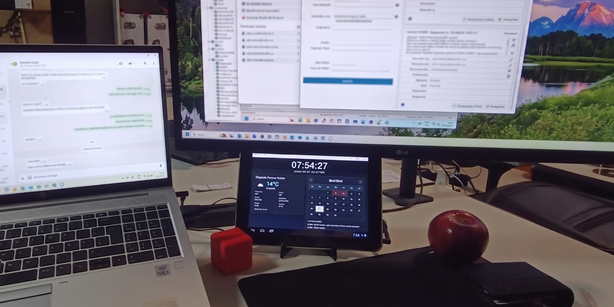

*Texto original: 21/04/2026. Actualización: 23/11/2026 (revisión editorial y estructura).*

Acomodando el cajón de los aparatos viejos, ese lugar intermedio entre lo que todavía sirve y lo que uno no se decide a tirar, encontré una **CX Boreal II de 9.7"**, con **Android 4.1.1**. La había usado para leer PDF, aunque pasarle archivos por SD ya se había vuelto bastante tedioso. Tiene las librerías y los certificados raíz de otra época, así que hoy casi nada funciona como debería, pero todavía tiene una linda pantalla y una batería que aguanta unas horas.

Antes de mandarla al descarte, me pregunté si podía servir como terminal fija para mostrar algo útil. Terminé convirtiéndola en una pantalla para una página propia del sitio: [**`/panel/`**](https://www.marchiori.ar/panel).

  
  

    Un momento... ¿es algo útil esto? No demasiado. Pero bueno, es una nerdeada pintoresca. A todo nerd le interesa el clima y la fecha; bueno, eso en realidad le interesa a mucha gente. La parte nerd es la pantallita.
  

## Ingredientes

- Tablet CX Boreal II 9.7" (2013 aprox.)
- Android 4.1.1 Jelly Bean
- API 16
- Recursos bastante limitados para los estándares actuales

Quería dejarla mostrando un reloj, la fecha, el clima de Marcos Juárez, un calendario mensual y los feriados, sin exigirle mucho más a un equipo de esa edad.

## El panel

Preferí hacer una página específica dentro del sitio Hugo para no depender de una aplicación abandonada o de una Play Store que ya no funcionaba. Además, podía adaptar la interfaz a la pantalla de la Boreal II y conservar la posibilidad de reutilizar el panel en otro equipo.

### Navegadores y certificados

Lo primero era conseguir que la tablet abriera el sitio. Si no, era leña.

Los navegadores que venían con Android 4.1.1 mostraban errores de certificado y avisos de conexión no privada, algo esperable con un sistema que lleva tantos años sin actualizarse: los certificados raíz envejecen, las cadenas de confianza cambian y cada vez hay menos compatibilidad con los sitios actuales. Tampoco podía recurrir a la Play Store.

Busqué alternativas en F-Droid y probé la posibilidad de usar un navegador tipo *kiosk*, pero las versiones compatibles con Android 4.1.1 ya no estaban disponibles. Chrome tampoco resolvía el problema, así que terminé con el viejo y confiable **Firefox** (`fennec-68.11.0.multi.android-arm.apk`), que manejó mejor los certificados del sitio y permitió evitar las limitaciones del WebView del sistema. Antes de instalarlo, deshabilité algunas aplicaciones de fábrica que ya no aportaban nada para dejar la tablet lo más liviana posible.

## Qué se hizo del lado del sitio

Acá entró **ChatGPT 5.4 Thinking**, que generó casi todo el código HTML a partir de lo que le iba pidiendo. Fuimos probando cuatro versiones del panel: una *light*, otra conectada a JSON, una por API y una más moderna. Esta última terminó funcionando bien con Firefox, así que descarté las anteriores.

La pantalla consulta `api.open-meteo.com` para el clima y `api.argentinadatos.com` para los feriados. El diseño quedó como una página independiente dentro del sitio, legible y liviana para que pudiera mostrarla un equipo tan viejo.

Hubo un problema al publicarla: en local las APIs respondían, pero en producción no aparecía la información. La política de seguridad del sitio bloqueaba esas conexiones hasta que ajusté la [CSP en Cloudflare](/site-log/hardening-del-sitio-en-cloudflare/) y agregué los permisos necesarios en `connect-src`.

Durante las pruebas también usé **Gemini** para explorar compatibilidades y alternativas que todavía pudieran funcionar con Android 4.1.1. Al final recurrí a Gemini para resolver la pantalla completa de Firefox con un pequeño script, porque ChatGPT se había puesto algo reticente con la idea de usar JavaScript. El script actúa solamente con el primer toque: al abrir el panel y tocar la pantalla, Firefox entra en *fullscreen* sin intentar repetir esa acción en cada interacción.

## Lo que quedó funcionando

La Boreal II terminó como una terminal fija con el panel abierto. Es un uso bastante acotado, pero aprovecha una pantalla y una batería que todavía sirven.

*La CX Boreal II corriendo el panel desde Firefox.*

El experimento tampoco le devuelve la utilidad que alguna vez tuvo como tablet: navegar por sitios modernos, instalar aplicaciones o usar servicios habituales sigue siendo complicado. Para mostrar un panel propio, en cambio, alcanza con ese Firefox y una función bien delimitada.

## Lo bueno: del proceso

Lo más entretenido fue el recorrido hasta llegar a algo que funcionara, entre pruebas con software viejo, ideas que no iban a instalarse y cambios sobre el sitio. ChatGPT aportó la mayor parte de los archivos y Gemini ayudó a destrabar problemas concretos, pero la decisión de qué probar, qué descartar y cómo usar la tablet fue saliendo del intercambio.

Después de terminar me quedan dudas profundas... ¿Esto va en Notas, en Site Log o se ganó directamente un lugar propio? ¿Un menú Labs? ¿Nerdeadas? ¿Cosas raras? 🤔

Por ahora, quedó en Labs. Bastante justo.

> Podés descargar una copia de los archivos principales del panel acá:  
> [panel-tablet-vieja.zip](panel-tablet-vieja.zip).
>
> Incluye el layout HTML, el script base, el JSON local de feriados y los íconos del clima.

-----------

<strong>Update 2026-05-17:</strong> el panel dejó de estar atado solo a Marcos Juárez. Ahora suma ciudades rápidas y un botón <strong>Otra</strong> para buscar cualquier ciudad mediante geocoding. Marcos Juárez sigue como opción por defecto, pero el panel guarda la última ciudad usada.

