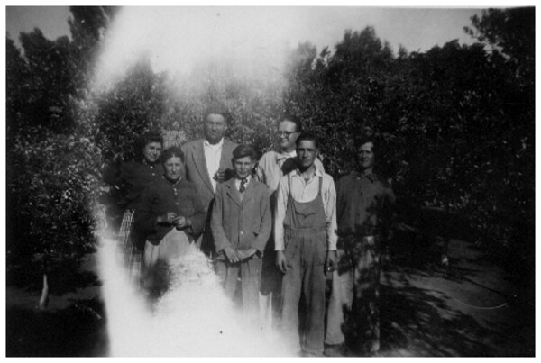
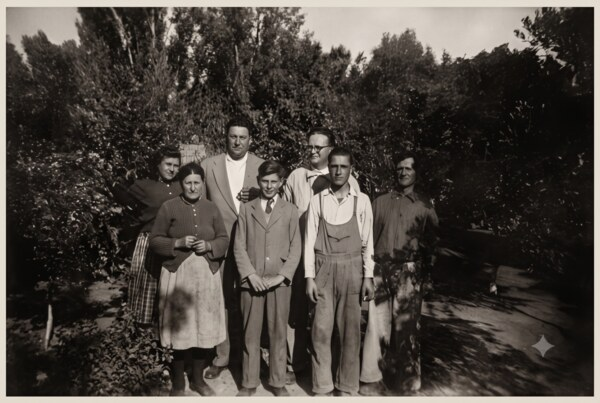
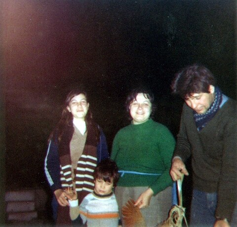
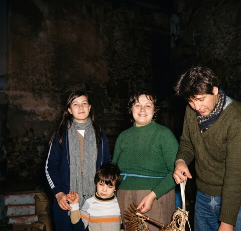
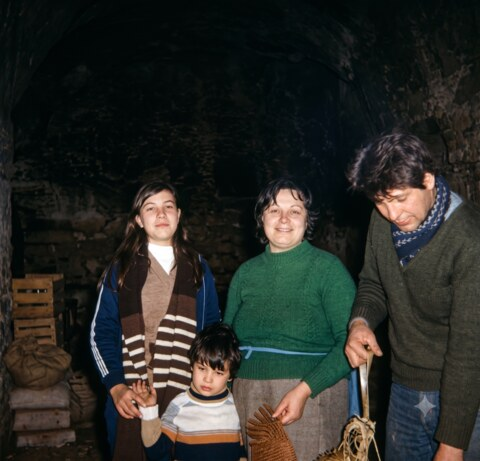

*Texto original: 28/06/2026. Actualización: 23/11/2026 (revisión editorial y estructura).*

## Fotos viejas, frío y una excusa para probar IA

Hoy OneDrive me mostró en el teléfono uno de esos recuerdos de "por esta época, hace algunos años". Entre las imágenes aparecieron fotos de mis abuelos y parece que hace unos seis años, también por esta época, hacía frío y yo estaba haciendo lo mismo que ahora: acomodando fotos viejas. 😬

Venía experimentando con instrucciones para restauración digital en Gemini, así que aproveché para armar un Gem dedicado a las fotografías antiguas. Preparé dos versiones del *prompt*, las probé con fotos familiares y comparé los resultados, prestando especial atención a esos detalles que una imagen generada puede mejorar visualmente y, al mismo tiempo, alterar.

## Qué le estamos pidiendo a Gemini

En esta prueba, un **prompt** es el conjunto de instrucciones que define cómo tratar la foto, qué deterioros corregir y qué límites respetar. Un **Gem** es una configuración personalizada de Gemini que permite guardar esas instrucciones y volver a usarlas sin copiarlas cada vez; Google explica su funcionamiento en la [documentación de Gems](https://support.google.com/gemini/answer/15235603).

El **motor de imagen** es el componente que genera o modifica el resultado visual. En las pruebas originales usé la herramienta que tenía disponible entonces en Gemini, identificada como Imagen 3. También hablo de **orquestador** para referirme a la capa que interpreta el pedido y lo encamina al motor de imagen. No puedo ver cómo toma internamente cada decisión, pero el resultado permite reconocer un problema: cuando la herramienta interpreta "restaurar" como "crear una versión más completa y prolija", puede reconstruir detalles que la foto nunca llegó a registrar.

Gemini trabaja con una imagen de referencia, aunque eso no equivale a restaurar píxeles de manera controlada, como se haría en una edición manual por capas. Si una zona está dañada o demasiado oscura, el modelo puede producir una solución visualmente convincente sin disponer de información suficiente para saber qué había allí.

## Dos versiones del prompt

La primera versión busca limpiar ruido, recuperar contraste y detalle, corregir deterioros y mantener la mayor fidelidad posible. Incluye restricciones para no agregar personas u objetos, modificar poses o expresiones, inventar fondos o cambiar una fotografía en blanco y negro a color. También pide una sola imagen como resultado, sin armar paneles comparativos.

Después armé una segunda versión más conservadora, con instrucciones dirigidas también a la interpretación del pedido por parte de Gemini. Presta especial atención a las caras, las manos y otras zonas anatómicas, porque son lugares donde una reconstrucción convincente puede terminar inventando la identidad o los rasgos de alguien. Si faltan datos, prefiero una zona ligeramente borrosa o una reparación discreta antes que una cara nítida que jamás estuvo en el original.

La segunda versión también insiste en conservar los objetos, la distribución de la escena, las texturas y el espacio de color. Son límites útiles para orientar la generación, aunque ningún prompt garantiza que se respeten siempre: hay que comparar la imagen terminada con la foto de partida.

## Cuando restaura y cuando inventa

La primera prueba fue con una fotografía antigua en blanco y negro, con manchas, zonas lavadas, pérdida de detalle y una parte bastante afectada sobre el margen izquierdo. Gemini recuperó contraste, limpió buena parte de los defectos visibles y reconstruyó zonas del fondo y de la parte inferior sin alterar demasiado el clima de la imagen.

  

  

*Primer ejemplo: la imagen restaurada permite distinguir mejor la escena y conserva bastante bien el aspecto de la fotografía original.*

La segunda prueba fue más complicada: una foto familiar a color, con poca luz, mucho grano, un flash duro y zonas donde apenas se distingue lo que había. Con el primer prompt, Gemini mejoró el contraste y la definición de las caras, pero empezó a reinterpretar elementos concretos.

El caso más evidente fue la martineta colorada (o simplemente "colorada" ☺️) que aparece en la fotografía. En la primera restauración dejó de parecer un ave y se transformó en una especie de objeto con alas de madera. Cuando la IA divaga, el resultado puede acercarse más al [Ecce Homo de Borja](https://www.infobae.com/cultura/2022/08/08/10-anos-del-ecce-homo-de-borja-la-peor-restauracion-de-la-historia-icono-pop-o-arte/) que a una recuperación fiel, aunque aquí el desastre fue bastante más discreto.

También cambió la bufanda de mi hermana: el dibujo de la tela se convirtió en otro patrón, más uniforme y prolijo. En el fondo, donde había oscuridad y poca información, apareció una pared de piedra bien definida que la foto original no permite confirmar. Son detalles fáciles de pasar por alto cuando el resultado general se ve mejor.

Con el segundo prompt, la martineta siguió siendo reconocible, el patrón de la bufanda quedó más cerca del original y el fondo conservó las irregularidades y la oscuridad de la escena, sin tanta invención. La imagen todavía contiene reconstrucción generativa, pero algunos de los desvíos más notorios se redujeron.

  

  

  

*Segundo ejemplo: original, restauración con el primer prompt y restauración con el segundo. La versión más conservadora respeta mejor los detalles que todavía se distinguen en la foto.*

Esta comparación me sirvió para ajustar el criterio: limpiar ruido sin plastificar, recuperar contraste sin modernizar la escena y, cuando faltan datos, aceptar las limitaciones del original. Una restauración puede ser más nítida y agradable de mirar sin ser necesariamente más fiel, algo importante cuando se trabaja con recuerdos familiares.

## Cómo crear un Gem para restaurar fotos

En Gemini se abre la sección **Gems**, se crea uno nuevo, se le pone un nombre (por ejemplo, "Restaurador Fotográfico") y se pegan las instrucciones en el campo correspondiente. Después alcanza con abrir ese Gem y subir la fotografía; también se puede invocar con `@` desde el chat principal, fijarlo en el panel lateral o guardar su dirección como marcador.

Conviene definir claramente si el Gem debe procesar la imagen o solamente ayudar a redactar instrucciones. Si no se quieren usar Gems, los prompts pueden guardarse como archivos de texto y pegarse manualmente al iniciar una conversación.

## Prompts utilizados

Dejo las dos versiones originales para probarlas o adaptarlas:

- [Prompt de restauración fotográfica, versión 1: restauración por capas](restaurar-fotos-viejas-gemini-prompt-v1-restauracion-por-capas.txt)
- [Prompt de restauración fotográfica, versión 2: restauración conservadora](restaurar-fotos-viejas-gemini-prompt-v2-restauracion-conservadora.txt)

La primera organiza las etapas de mejora y la segunda agrega restricciones para los casos donde Gemini completa información que falta. Ninguna reemplaza la revisión de cada resultado, porque una foto en blanco y negro, con daño físico, plantea problemas diferentes de una escena familiar oscura donde aparecen personas y objetos difíciles de reconocer.

## Google AI Pro gratuito para estudiantes en Argentina, Chile y Perú

En [un anuncio de Google publicado en octubre de 2025](https://blog.google/intl/es-419/actualizaciones-de-producto/informacion/la-ia-de-google-al-alcance-de-todos-llega-a-hispanoamerica-ai-plus-y-el-gemini-gratuito-para-estudiantes/) se ofreció un año sin costo de **Google AI Pro** a estudiantes universitarios mayores de 18 años de Argentina, Chile y Perú. Lo mencioné porque el acceso a algunas funciones avanzadas depende del plan, la región y los modelos disponibles en cada momento.

*Actualización al 23/11/2026:* el beneficio de un año gratuito para estudiantes elegibles sigue disponible en Argentina, aunque la oferta actual se presenta como **Google AI Plus**, en lugar del AI Pro mencionado en el anuncio anterior. La página oficial indica que se puede solicitar hasta el **31/12/2026**, sujeto a los requisitos de la promoción. Los detalles vigentes y el acceso están en [Gemini para estudiantes](https://gemini.google/students/).

## Mejorar una foto sin cambiar su historia

Estas pruebas me dejaron una precaución bastante concreta: cuando Gemini devuelve una imagen más limpia, conviene mirar con cuidado qué recuperó a partir de la foto y qué pudo haber completado por su cuenta. Para experimentar y volver a disfrutar imágenes deterioradas puede ser una herramienta muy útil, pero cuando la fotografía tiene valor familiar o documental, el original sigue siendo la referencia con la que hay que comparar cada detalle.
