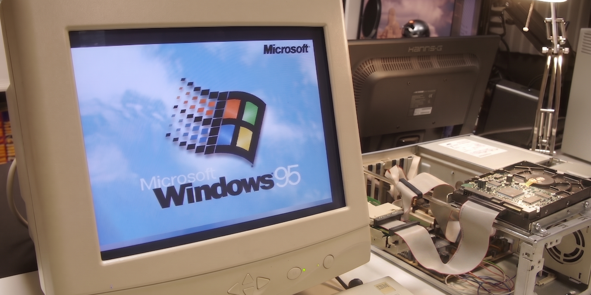
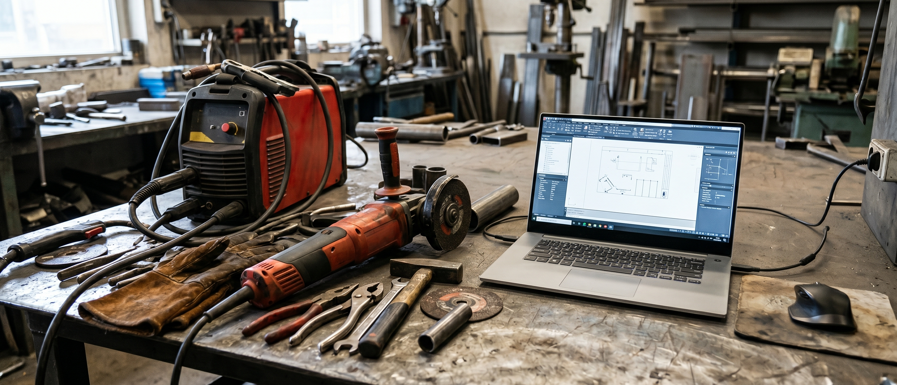
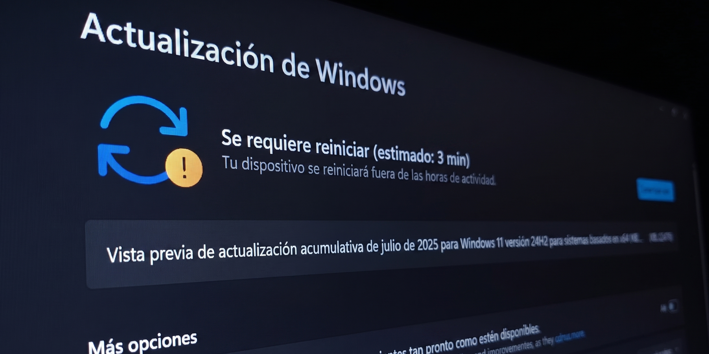
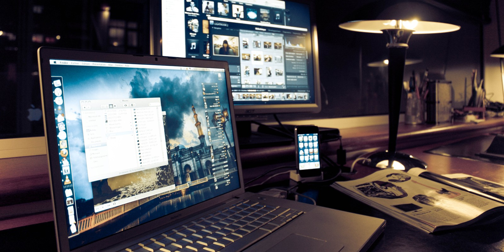

*Texto original: 22/08/2026. Actualización: 23/11/2026 (revisión editorial y estructura).*

Allá por los noventa, cuando armábamos PCs, era bastante común copiarle al pobre disco rígido de 120 MB un directorio con “todo lo necesario” 🙃. Podía traer Word, Excel, AutoCAD, CorelDraw, Print Artist, algún antivirus, juegos y varias cosas más que el usuario probablemente nunca iba a abrir. Daba lo mismo si la máquina era para un oficinista, un estudiante o alguien que solo necesitaba escribir dos cartas y hacer una planilla. Se copiaba todo y “gratis”.

> Sí, 120 MB. Megabytes. Y sí, en ese momento eran directorios, no carpetas.

Lo de gratis iba entre comillas, claro. Eran tiempos de DOS y Windows 3.x, mientras llegaba Windows 95 (¡en unos quince diskettes!), con mucho clon, poca PC de marca y alguna Compaq Presario dando vueltas. Yo recién empezaba a meter mano en estas cosas y tenía bastante más entusiasmo que conocimiento; sabíamos instalar programas, hacer entrar medio mundo en un disco y conseguir que la máquina arrancara, pero de licencias y derechos de uso entendíamos poco o nada.

Las copias circulaban durante años, las licencias eran caras y la protección contra copias era bastante limitada. Internet recién empezaba a aparecer por estas latitudes, las actualizaciones se hacían muchas veces a mano y todavía no existía esa relación permanente entre la PC y los servicios en línea. Nada de eso volvía legítimo copiar programas sin licencia, pero ayuda a entender cómo se instaló aquella costumbre.

## “Te la dejo con todo”

Muchos armadores ni siquiera incluían el sistema operativo como un ítem del presupuesto. El cliente compraba la computadora y Windows aparecía instalado, listo para usar; ofrecer la licencia por separado podía encarecer tanto el equipo que uno terminaba perdiendo la venta. Con Office pasaba lo mismo, así que la PC se entregaba “con todo” y el software quedaba como una especie de gentileza del vendedor.

De aquella época quedó una costumbre difícil de sacar: cobrar el fierro y dar por supuesto que el software venía incluido. Para muchos clientes pagar una licencia parecía un sobrecosto innecesario, y tampoco era tan sencillo explicarles qué ventaja concreta obtenían. En ese entonces, con poca conectividad y sin la cantidad de activadores que aparecieron después, el argumento más evidente era evitar problemas legales 🤷‍♂️.

> Fuera de lo legal, también se entiende por qué deberías pagar el software. El desarrollador y el técnico no se nutren de bits succionados de un conector RJ45 (u 8P8C, para los canónicos) 😊.

Treinta años después la responsabilidad es distinta. Si hoy vendés, armás o configurás una computadora, corresponde explicarle al cliente qué programas necesita, cuánto cuestan y qué alternativas tiene, en lugar de decidir por él “total, se lo ponemos trucho”. Una máquina entregada con “Windows, Office y todo andando” puede estar dependiendo de un activador bajado de vaya uno a saber dónde, que además hace vaya uno a saber qué cosa.

> Microsoft será una corporación malvada, pero seguro TeamDaz, Ratiborus, los de KMSpico o SolidSQUAD son gente piola y de confianza 🤔.

## Fierro y software, mens sana in corpore sano

A menudo alguien empieza buscando “una buena PC” y recién después piensa qué programas va a utilizar, cuando las tareas y el software deberían orientar la elección del hardware. AutoCAD, Illustrator, un sistema contable o cualquier herramienta específica pueden determinar los requisitos de la máquina y buena parte del costo total. Hacerlo al revés puede terminar en un Ferrari para ir al súper o en una carreta para correr una carrera, y cuando aparece el precio de los programas llega el glorioso “Office te lo pongo yo”. Guiño, guiño 😉.

> Nadie monta una línea de producción suponiendo que la soldadora va a aparecer gratis después. Con informática todavía pasa.

Eso no obliga a comprar licencias que no hacen falta. Para una casa, [Microsoft 365 Familia](https://www.microsoft.com/es-ar/microsoft-365/p/microsoft-365-family/cfq7ttc0k5dm) puede servir a varias personas e incluir almacenamiento en OneDrive; en una oficina o empresa corresponde evaluar los planes comerciales, y siempre vale la pena revisar si una herramienta libre o una que ya se tiene cubre la necesidad.

También hay que considerar el trabajo detrás del software sin costo de licencia. Linux puede instalarse sin pagar por el sistema operativo, pero necesita mantenimiento y soporte, y algunas aplicaciones, bases de datos, servicios de backup, monitoreo o productos empresariales como Db2 tienen costos propios. Lo que importa es presupuestar la solución completa y no esconder una parte para que el número cierre. Ponerle un Office crackeado a la PC de alguien que trabaja con datos propios y de sus clientes es pijotear justo en una herramienta fundamental.

## El atajo que después te ata

Hay cierta cultura del técnico que siempre encuentra la vuelta con RDPWrap, una VPN gratuita de procedencia dudosa, un activador o algún parche para forzar una función. Muchas veces anda, y justamente ahí está el problema: puede funcionar lo suficiente como para que una empresa construya su trabajo encima y, seis meses después, nadie recuerde qué se tocó. El día que una actualización deja RDPWrap fuera de combate, alguien tiene que averiguar qué se hizo y cómo recuperar el servicio sin dejar a todos parados.

Con los cracks se suma un riesgo de seguridad bastante concreto. Algunos activadores piden deshabilitar el antivirus o agregar exclusiones para funcionar; si el ejecutable hace algo distinto de lo prometido, el equipo queda con menos posibilidades de detectarlo. En una computadora que almacena contraseñas, abre adjuntos, sincroniza archivos y accede al home banking, el riesgo alcanza bastante más que al programa que uno quería instalar.

Hace un tiempo se popularizaron las claves de Windows a precios ridículamente bajos, una alternativa que puede evitar el uso de un crack, pero cuya procedencia merece atención. La clave llega, activa por Internet y hasta puede venir con factura, aunque nada de eso garantiza que otorgue una licencia legítima para ese equipo. Hay licencias Retail, OEM y por volumen, con derechos y condiciones diferentes; que Windows figure como “activado” describe su estado técnico, mientras que la validez del derecho de uso depende del origen y las condiciones de la licencia.

En una PC doméstica alguien puede decidir asumir ese riesgo si sabe lo que está comprando. En una empresa conviene usar un canal identificable o adquirir el equipo con Windows de fábrica, porque una factura por una clave dudosa prueba que se pagó por ella, pero no necesariamente que el vendedor tuviera derecho a revenderla. Si la única explicación disponible es “es original porque activa”, suerte con eso el día que haya que defender la instalación en una auditoría.

Basar el trabajo de un diseñador en un Illustrator trucho me recuerda a poner a un herrero a soldar todos los días con una soldadora enchufada a un tomacorriente de velador. Puede andar durante bastante tiempo, hasta que falla y deja a alguien sin trabajar, con el agravante de que la computadora también guarda información sensible. Peor todavía si para conservar funcionando algún parche hay que desactivar Windows Update: ahí una solución improvisada empieza a condicionar la seguridad de todo el equipo. Basta mirar la [guía de actualizaciones de seguridad de Microsoft](https://msrc.microsoft.com/update-guide/) para comprobar que aparecen vulnerabilidades nuevas continuamente.

## Dejarla lista de verdad

Preparar una computadora para trabajar incluye pensar qué pasará con los datos si mañana la roban o se rompe el disco. Una notebook puede tener años de presupuestos, fotografías, documentos y carpetas de clientes, y serviría de poco haber instalado todos los programas si el único ejemplar de ese trabajo quedó en `C:\Users\Fulano\Documents`. Conviene hablar de respaldos desde el principio: OneDrive, Google Drive, un NAS, un disco externo o una combinación adecuada al uso que se le va a dar.

En los noventa hacíamos lo que sabíamos y lo que el entorno permitía. Hoy el cliente tiene más alternativas y el técnico también tiene más información y responsabilidad para explicarlas. Si alguien decide ahorrar y aceptar determinadas limitaciones, que sea con conocimiento de lo que implica; instalarle un crack sin decirle nada es tomar por él una decisión que le corresponde al dueño de la computadora.
