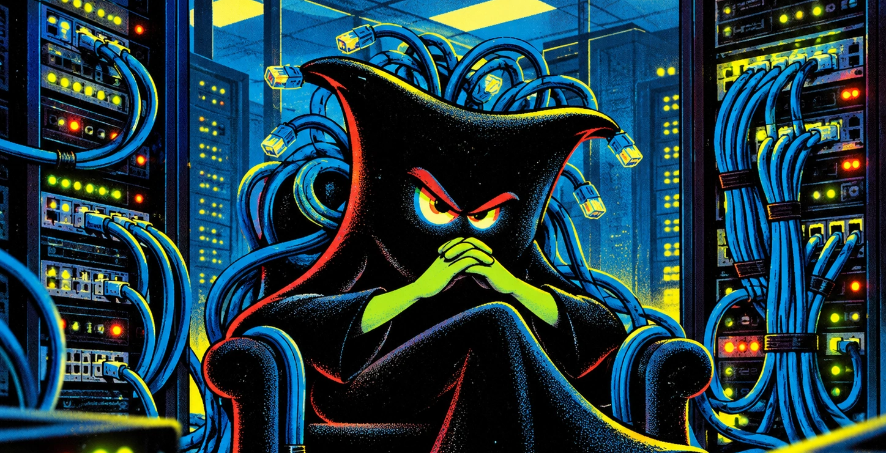

*Texto original: 25/04/2026. Actualización: 23/11/2026 (revisión editorial y estructura).*

## Cuando nadie mira más allá de su propio ombligo (o de su propia pantalla)

Decime si no te pasó alguna vez: un usuario avisa que una aplicación tiró un error, alguien de Infraestructura alcanza a decir "esto parece de la aplicación" y del otro lado ya apareció el diagnóstico exprés: "es la red".

Un timeout al guardar un registro, es la red. La aplicación falla en una sucursal, es la red. Se cuelga cuando varios usuarios trabajan a la vez, también es la red. Hasta cuando solo falla esa aplicación y todas las demás siguen funcionando, la red sigue siendo la sospechosa. Para algunos parece un éter místico y maligno capaz de elegir a qué proceso molestar mientras todo lo demás anda normalmente.

Y cuando preguntás por qué es la culpable, la explicación suele tener la precisión técnica de una historia del abuelo Simpson.


Ojo, la red falla. También fallan firewalls, DNS, switches y enlaces. Mi queja (sí, dije queja, chupate esa, coach!) es el diagnóstico automático, sin evidencia, que manda el problema a Infraestructura antes de leer el error completo, revisar los logs o averiguar qué estaba haciendo la aplicación cuando falló.

## El ciclo de vida de un bug "de infraestructura"

El ciclo suele tener etapas bastante reconocibles:

**Negación:** "En mi máquina funciona".  
**Delegación:** "Debe ser un problema de red o latencia".  
**Evidencia:** Infraestructura muestra conectividad, puertos, rutas, DNS y logs, todo eso que nadie había pedido antes de culparla.  
**Aceptación forzada:** "Ah, entonces debe ser otra cosa".  
**Resolución:** aparece un parche de la aplicación que casualmente corrige el problema que no era de la aplicación.

Puede haber apuro, exceso de confianza, desconocimiento o poca investigación (y alguna vez, quizá, mala fe 🤨). Lo macana es cuando esa falta de análisis se presenta como certeza técnica.

> El "complejo de Dios" 😅 aparece cuando alguien da su propia lógica por infalible, deja de investigar y empieza a defender territorio.

## Para empezar, mirarse el ombligo

Ahh, y la fatality... preguntás por qué no revisaron primero la aplicación y te contestan: "Tenés que entender que es programador, no sabe de Infraestructura". Bárbaro, nadie le pidió que configurara un switch; alcanzaba con leer el error, revisar qué estaba ejecutando su programa y hacer alguna prueba antes de derivarlo. Si no sabe qué está pasando, puede pedir ayuda. Eso sería bastante más colaborativo.

Cuando un sistema pasa del entorno de desarrollo al trabajo cotidiano aparecen condiciones que quizá no estaban en la prueba: usuarios simultáneos, permisos, conexiones, bloqueos de SQL, timeouts y fallos que no se habían previsto. Si hay una transacción mal manejada o una excepción sin capturar, habrá que revisar el código; y si realmente falló la red, lo resolveremos nosotros. Para eso estamos.

Una aplicación tiene que sobrevivir donde va a funcionar. Tenés que capturar errores, papá, loguear lo que pasa y pensar que tu aplicación va a ir a la guerra, no a una demo con café y aire acondicionado.

## La mancha venenosa

Al grito de "es la red", el problema cambia de escritorio. Quien lo derivó sigue con lo suyo y nuestra parte queda señalada como culpable, aunque nadie haya mostrado una prueba. Nosotros tenemos que interrumpir lo que estamos haciendo para demostrar que el problema no estaba ahí. Y urgente, por supuesto.



*"La red", la más mala de todas... ¡Muajajajá!*

Encima, si no salís corriendo a revisar todo con cara de preocupado, ya sos poco colaborativo. Ni se te ocurra preguntar qué pruebas hicieron antes de derivar el ticket, porque podés terminar siendo vos el que tiene un problema de actitud.

Después aparece un parche de la aplicación, un pase mágico y todo vuelve a funcionar, sin demasiadas explicaciones sobre qué pasó ("era el perfil roto del SQL", ¿wtf?). El usuario vuelve a trabajar y el desarrollador sigue adelante, mientras nosotros cargamos con la sospecha. Mil puntos para Gryffindor (por si quedan dudas, Infraestructura es Hufflepuff).

A cualquiera le puede fallar un diagnóstico. Lo que molesta es que se puedan derivar problemas sin investigarlos y que termine siendo el complicado quien pide averiguar qué pasó.

## Mean Time to Innocence

Hasta hay una expresión bastante irónica para este mecanismo: **Mean Time to Innocence**, o tiempo medio hasta demostrar inocencia. Es una métrica informal sobre cuánto tarda un área en probar que un incidente no era de su responsabilidad. Cuando se empieza repartiendo culpas, primero hay que despejar sospechas y recién después buscar la causa real, mientras el usuario sigue esperando.

> **La ley de gravedad de los tickets**
>
> Un error siempre tiende a caer hacia abajo en las capas del modelo OSI.
>
> Empieza en capa 7, aplicación, pero por comodidad baja hasta capa 3, capa 2 o directamente capa 1. Ahí queda esperando que Infraestructura lo suba de nuevo, con evidencia, logs, capturas y pruebas de conectividad.

## ¿Y por qué le creen?

También influye quién está más cerca de los usuarios y la gerencia. Los desarrolladores participan de proyectos de sistematización, conversan con las distintas áreas y suelen tener contacto directo con quienes toman decisiones, así que su explicación llega primero y muchas veces se acepta sin demasiadas preguntas.

Infraestructura es el backplane invisible del sistema: si anda bien, nadie lo nombra; si algo falla, aparece como sospechoso antes de que alguien lea el mensaje de error.

En eso último también hay algo nuestro. Muchas veces Infraestructura se vende peor de lo que trabaja, con perfiles más orientados a resolver que a explicar. ~~Y no nos gusta mezclarnos con los ignaros.~~


*Todavía nos imaginan encerrados en el cuarto de servidores como Richmond Avenal, el "Server Room Guy" de [The IT Crowd](https://www.youtube.com/show/VLPLQxUFrtzYaUlfC1e_wcoaUGC02HPVHSW4?sbp=KgtOTlJRYURrUTdGOEAB). Otra idea para mi libro "Me lo dijo un coach".*

Explicar hacia "arriba" tampoco siempre es fácil. A veces hay que traducir logs, capturas y pruebas para personas que creen que un senior de Infraestructura se fabrica con un cursito de seis meses y que todo anda por magia (el complejo de Dios del de RR. HH. o del coach, pero eso da para otra nota).

Y acá entran los jueces (jefes, gerentes) que quizá no saben de qué hablamos, pero escuchan una explicación con mucha seguridad escénica y la dan por buena. Podrían decirles que es la crapodina del micro y ~~como no quieren dejar en evidencia que no saben un corno~~ algunos terminarían aceptando la primera hipótesis, sobre todo si en su casa también falla el wifi. Entonces sí, seguro que "es la red". A veces falta interés en meterse en el problema y otras veces se prefiere evitar un conflicto.

Si nadie pide evidencias cuando se deriva mal un incidente, la próxima vez se repite la historia. Total, ya sabemos quién tiene que demostrar que no fue la red.

## La IA como primer filtro

Cuando aparece un error en una aplicación que no desarrollaste, interpretar una excepción puede ser difícil si desconocés el lenguaje, las bibliotecas o la base de datos, y durante mucho tiempo dependíamos de que el desarrollador quisiera investigarlo y explicarlo.

Hoy una IA puede ayudar a leer el mensaje, distinguir un timeout de conexión de uno de ejecución, detectar indicios de un bloqueo SQL y proponer comprobaciones. Las respuestas pueden orientar la investigación, pero hay que contrastarlas con los registros y las pruebas reales. Al menos permiten llegar a una conversación técnica con algo más que la sospecha inicial.

También se puede investigar sin tener el código fuente. ¿Probaste alguna vez inspeccionar un ejecutable? Te sorprendería cuánto puede quedar dentro de un `.exe`: cadenas de conexión, nombres de servidores, rutas internas, configuraciones, endpoints, tokens mal guardados o incluso datos personales.

Precisamente por eso hay que tener cuidado antes de compartir una aplicación interna con ChatGPT, Gemini o Claude. Un ejecutable puede parecer una caja negra, pero a veces es más parecido a una valija mal cerrada.

## Un prompt antes de repartir diagnósticos

Para empezar una investigación, a veces alcanza con llevarle a una IA el error completo, quitando previamente contraseñas, datos personales o cualquier información sensible, y pedirle que organice los indicios. Por ejemplo:

```text
Analizá este error de una aplicación conectada a una base de datos.

Indicame si corresponde a error de red, error de conexión,
timeout de ejecución, bloqueo de base de datos o problema
de código.

Explicá qué operación estaba intentando hacer la aplicación
y qué componente conviene revisar primero.

Error:
[pegar acá el texto completo del error]

Además, sugerime qué pruebas mínimas harías para orientar
el análisis hacia el componente correcto.
```

Con eso tenés un punto de partida para investigar y comprobar qué pasa realmente. Para todo el universo que queda fuera de la pantalla no tengo receta. ¡Ojalá te sea leve! 😁
