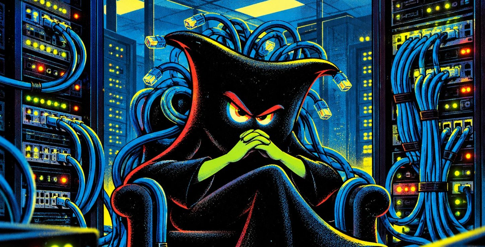

## Cuando nadie mira más allá de su propio ombligo (o de su propia pantalla)

Decime si no te pasó algo parecido alguna vez: un usuario avisa que una aplicación tiró un error, alguien de Infraestructura mira el mensaje y alcanza a decir “esto parece de la aplicación”, pero del otro lado ya apareció el diagnóstico express... “es la red”.

Un timeout al guardar un registro: es la red. La aplicación falla en una sucursal: es la red. Se cuelga cuando varios usuarios trabajan al mismo tiempo: es la red. Y si solo falla esa aplicación mientras las demás siguen funcionando, bueno, también es la red. Para ciertos diagnósticos apurados, "la red", parece un éter místico y maligno que elige a qué proceso molestar mientras todo lo demás funciona.

Sí, "la red" es ese sospechoso universal que siempre esta cerca de la escena del crimen. Y cuando preguntás por qué es la culpable, la explicación suele tener con la precisión técnica de una historia del abuelo Simpson.


Ojo, la red falla. Los firewalls fallan, el DNS falla, los switches fallan, los enlaces fallan, los etcéteras también fallan.

Mi queja (sí, dije queja, chupate esa, coach!) es ese diagnóstico automático, cómodo y sin evidencia. Saltar directo a Infraestructura antes de leer el error completo, revisar logs o averiguar qué estaba haciendo la aplicación cuando falló.

## El ciclo de vida de un bug “de infraestructura”

El ciclo suele tener etapas bastante reconocibles:

**Negación:** “En mi máquina funciona”.  
**Delegación:** “Debe ser un problema de red o latencia”.  
**Evidencia:** Infraestructura muestra conectividad, puertos, rutas, DNS, logs y todo eso que nadie pidió antes de culparla.  
**Aceptación forzada:** “Ah, entonces debe ser otra cosa”.  
**Resolución:** aparece un parche de la aplicación que casualmente corrige el problema que no era de la aplicación.

Ojo, no digo que siempre haya mala fe explícita (o sí 🤨). A veces hay apuro, exceso de confianza, poca investigación o directamente desconocimiento. Lo macana es cuando esa falta de análisis se disfraza de certeza técnica.

> Este “complejo de Dios” 😅 aparece cuando alguien asume que su lógica es infalible, deja de investigar y empieza a defender territorio.

## Para empezar, mirarse el ombligo

Ahh y la fatality... preguntás por qué no revisaron primero la aplicación y te contestan: “Tenés que entender que es programador, no sabe de Infraestructura”. Bárbaro, pero nadie le pidió que configurara un switch. Se le pidió que leyera el error, revisara qué estaba ejecutando su aplicación e hiciera alguna prueba antes de mandar el problema para otro lado. Y si no sabe qué está pasando, puede pedir ayuda. Bastante más colaborativo que desentenderse del asunto.

En análisis de sistemas (lo que debería hacer el desarrollador) uno puede imaginar el proceso ideal. Después, cuando toca implementarlo, aparecen las limitaciones reales: red, base de datos, locks, timeouts, usuarios simultáneos, permisos, recursos y errores que jamás aparecieron en el equipo del desarrollador. Si hay una consulta SQL bloqueada, una transacción mal manejada o una excepción sin capturar, habrá que revisarlo. Y si el problema es efectivamente de red, lo resolveremos nosotros. Para eso estamos.

Una aplicación tiene que sobrevivir en el ambiente donde realmente va a funcionar. Tenés que capturar errores, papá. Tenés que loguear. Tenés que pensar que tu aplicación va a ir a la guerra, no a una demo con café y aire acondicionado.

## La mancha venenosa

Y al grito de “es la red”, el problema cambia de escritorio. El que lo derivó gana tiempo y sigue con lo suyo. Mientras tanto, nuestra parte ya quedó señalada como culpable. Para colmo el que dijo “es la red” no tuvo que mostrar una sola prueba. Pero nosotros tenemos que dejar lo que estamos haciendo para demostrar que no era eso. Y urgente, por supuesto.



Encima, si no ponés cara de preocupado y salís corriendo a revisar todo, ya sos poco colaborativo. Y ni se te ocurra preguntar qué pruebas hicieron antes de derivarlo, no vaya a ser que termines siendo vos el que tiene un problema de actitud.

Después aparece un parche de la apliación, un pase magico y el problema desaparece y nadie explica demasiado qué pasó (fue le perfíl roto del SQL ¿wtf?). El usuario vuelve a trabajar, el desarrollador sigue con lo suyo y nosotros quedamos con la sospecha encima. Aunque el error nunca hubiera estado en nuestra parte. Mil puntos para Gryffindor (por si quedan dudas, Infraestructura es Hufflepuff).

Equivocarse en un diagnóstico le puede pasar a cualquiera. Lo que me molesta es que se puedan derivar problemas sin investigar, que nadie pida explicaciones y que quien intenta averiguar qué pasó termine siendo el complicado.

## Mean Time to Innocence

Esto tampoco pasa solamente en sistemas. Hasta existe una expresión bastante irónica para describirlo: **Mean Time to Innocence**, o tiempo medio hasta demostrar inocencia. No mide cuánto se tarda en resolver el problema. Mide cuánto tarda un área en demostrar que el problema no era suyo. Es una métrica informal, pero bastante reconocible. Cuando el diagnóstico arranca con prejuicios, primero hay que despejar sospechas y recién después buscar la causa. Mientras tanto, el usuario sigue esperando.

> **La ley de gravedad de los tickets**
>
> Un error siempre tiende a caer hacia abajo en las capas del modelo OSI.
>
> Empieza en capa 7, aplicación, pero por comodidad baja hasta capa 3, capa 2 o directamente capa 1. Ahí queda esperando que Infraestructura lo suba de nuevo, con evidencia, logs, capturas y pruebas de conectividad.

## ¿Y por qué le creen?

También influye quién está más cerca de los usuarios y la gerencia. Los desarrolladores suelen participar directamente de los proyectos de sistematización de procesos, hablar con las distintas áreas y tener más contacto con quienes toman decisiones. Su explicación llega primero y muchas veces se acepta sin demasiadas preguntas.

Infraestructura, en cambio, es como el backplane invisible del sistema: si anda bien, nadie lo nombra. Si algo falla, aparece como sospechoso antes de que alguien lea el mensaje de error.

Ojo, en eso ultimo también hay algo nuestro. Muchas veces Infraestructura se vende peor de lo que trabaja. Solemos tener perfiles más introvertidos, más orientados a resolver que a explicar. ~~Y no nos gusta mesclarnos con los ignaros.~~


*Todavía nos imaginan encerrados en el cuarto de servidores como Richmond Avenal, el “Server Room Guy” de [The IT Crowd](https://www.youtube.com/show/VLPLQxUFrtzYaUlfC1e_wcoaUGC02HPVHSW4?sbp=KgtOTlJRYURrUTdGOEAB). Otra idea para mi libro “Me lo dijo un coach”.*

Y explicar hacia “arriba” tampoco siempre es fácil. A veces hay que traducir logs, capturas y pruebas técnicas para gente que cree que un senior de Infraestructura se fabrica con un cursito de seis meses y que las cosas andan por magia (ahí está el complejo de Dios del de RR. HH. o del coach, pero eso da para otra nota).

Es entendible (pero no justificable) que a veces se le crea más al que vende una hipótesis con seguridad escénica que a quienes aparecemos con cara de “esto ya lo revisé tres veces” y las pruebas en la mano, claro... aca vienen los jueces (jefes, gernetes) que no tienen idea de lo que hablamos asi que le pueden decir que es la crapodina del micro y ~~ como no quieren dejar en evidencia que no saben un corno~~ terminan aceptando la primera versión que escuchan porque en la casa el wifi le falla mucho asi que si, es "la red". Al fin y al cabo no tienen ganas de meterse y otros prefieren evitar conflictos. 

Si nadie pide explicaciones cuando aparece un diagnóstico equivocado, la próxima vez se repite la misma historia. Total, ya sabemos quién tiene que demostrar que no fue la red.

## La IA como primer filtro

Hasta hace poco, cuando aparecía un error en una aplicación que no habías desarrollado, dependías bastante del conocimiento y de la buena voluntad de quien la había hecho. Si no conocías el lenguaje, las bibliotecas o la base de datos, interpretar una excepción podía ser complicado. Y si del otro lado no había muchas ganas de investigar, peor.

Hoy tenemos la IA para darnos una mano. No desaparece la necesidad de saber ni nos convierte automáticamente en desarrolladores o DBA, pero permite leer mejor una excepción, ordenar indicios y empezar a investigar con algún sustento.

Podés distinguir un timeout de conexión de uno de ejecución, encontrar indicios de un bloqueo SQL o averiguar qué pruebas convendría hacer. Después habrá que comprobarlo, porque la IA también se equivoca.

Pero ya no dependés exclusivamente de que alguien quiera explicarte qué significa el error. Podés investigar y llegar a una conversación técnica con algo más que una sospecha.

Y hay otras herramientas para investigar sin tener el código fuente. ¿Probaste alguna vez inspeccionar un ejecutable? Te sorprendería cuánto puede quedar adentro de un `.exe`: cadenas de conexión, nombres de servidores, rutas internas, configuraciones, endpoints, tokens mal guardados o incluso datos personales.

Eso tampoco significa que haya que subir alegremente aplicaciones internas a ChatGPT, Gemini o Claude. Al contrario. Hay que tener cuidado con lo que se distribuye y con lo que se comparte. Un ejecutable puede parecer una caja negra, pero a veces es más parecido a una valija mal cerrada.

## Un prompt antes de repartir diagnósticos

No hace falta empezar con una investigación digna de la NASA. A veces alcanza con copiar el error completo, pegarlo en una IA y pedirle que ayude a separar indicios. Eso sí, quitando previamente contraseñas, datos personales o información sensible.

Algo así:

```text
Analizá este error de una aplicación conectada a una base de datos.

Indicame si corresponde a error de red, error de conexión,
timeout de ejecución, bloqueo de base de datos o problema
de código.

Explicá qué operación estaba intentando hacer la aplicación
y qué componente conviene revisar primero.

Error:
[pegar acá el texto completo del error]

Además, sugerime qué pruebas mínimas harías para orientar
el análisis hacia el componente correcto.
```

Con eso al menos tenés por dónde empezar a investigar. Después habrá que comprobar qué pasa realmente, pero ya no dependés solamente de la explicación que te dieron.

Para todo el universo que queda fuera de la pantalla no tengo receta. ¡Ojalá te sea leve! 😁
