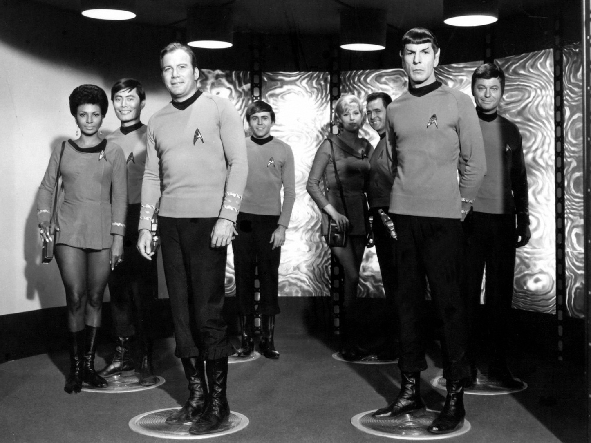
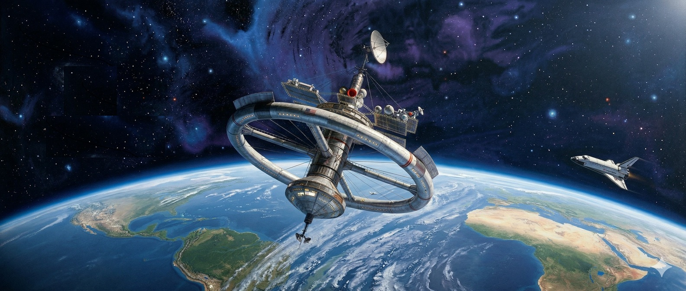
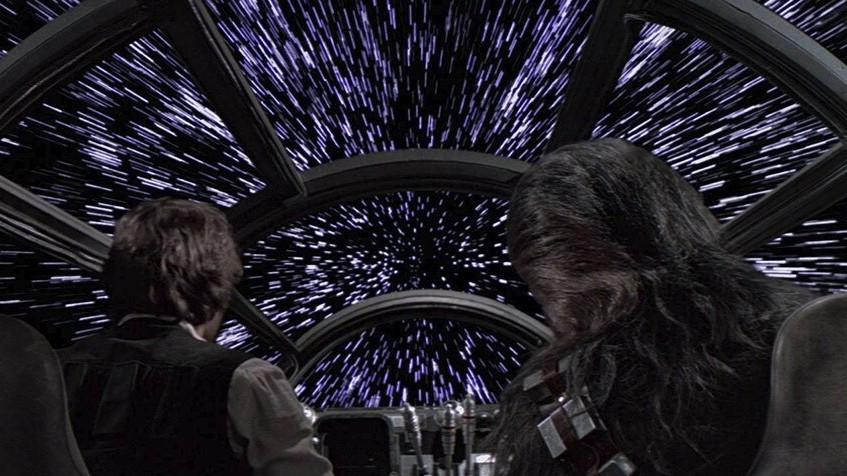
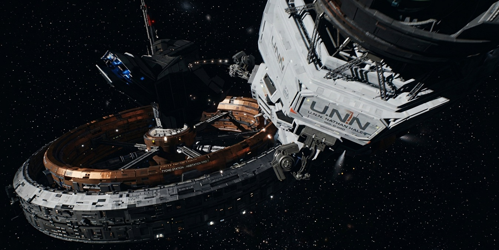

*Texto original: 12/04/2026. Actualización: 23/11/2026 (revisión editorial y estructura).*

## Cuando el espacio verdadero parece menos creíble que la ficción

Mi interés por el espacio y por este tipo de historias empezó con la televisión y el cine, sobre todo con [Star Trek](https://www.startrek.com/) y [Battlestar Galactica](https://www.primevideo.com/-/es/detail/Battlestar-Galactica-1978/0QFGSYXRXQP9D2AUR98XTDIXIA). Después llegó [Star Wars](https://www.starwars.com/), con toda su estética y su manera de convertir el espacio en escenario de aventuras. Mucho más tarde apareció [*The Expanse*](https://www.alconent.com/television/the-expanse) (gran serie, dicho sea de paso), que me llamó la atención por el esfuerzo de hacer creíbles las condiciones de un viaje espacial, incluso dentro de una historia de ficción.

Yo nací en 1976 y nunca vi *Star Wars*, *Star Trek* ni *Battlestar Galactica* en el cine; tampoco las alquilé en VHS. Todo eso me llegó por televisión. Para cuando tuve edad de registrar esas cosas, las tres primeras películas de *Star Wars* ya se habían estrenado y en Marcos Juárez el cine no traía ese tipo de material de manera regular. Más adelante seguí *Star Trek: The Next Generation* por TV, mientras que la serie original me llegaba en repeticiones, bastante salteada. También recuerdo el viejo cable de Marcos Juárez, aunque no sé si todavía se llamaba “Confort 2001” o si ya había pasado a Cablevisión. Por ahí empezaron a aparecer canales de afuera y en uno de Brasil llegué a mirar, o al menos a tratar de entender en portugués, capítulos de la serie original de *Star Trek*. Hasta ahí llegaba mi fascinación por esa serie.

Con los años empecé a mirar de otra manera esas historias. Algunas usan el espacio como escenario de aventuras y se toman todas las libertades que necesitan; otras incorporan, aunque sea parcialmente, las condiciones de la física real. Hay situaciones perfectamente normales en una misión espacial que el cine clásico casi nunca muestra y que, cuando aparecen, pueden parecer menos creíbles que una nave doblando como un avión.

## Una intuición hecha para la Tierra

Nuestra intuición está acostumbrada al aire, al roce, al ruido, al peso constante y a que los objetos terminen frenándose. Por eso, cuando escuchamos hablar de Artemis, de una cápsula que regresa a decenas de miles de kilómetros por hora o de una nave que continúa moviéndose con los motores apagados, es fácil imaginar maniobras como las del cine: naves que giran como aviones, explosiones que se oyen en el vacío y frenadas casi instantáneas.

La física que muchos vimos en la escuela, además, solía presentarse como una colección de cálculos antes que como una herramienta para entender esas situaciones. Bien explicada, podría haber mostrado que el comportamiento real de una nave espacial tiene bastante más para sorprendernos que muchas de las convenciones a las que nos acostumbraron las películas.

## En el espacio no se frena solo

Un avión que corta potencia puede planear, pero sigue dentro de la atmósfera, sometido a la resistencia del aire, a la gravedad y a la necesidad de mantener sustentación. Una nave espacial que ya está en movimiento puede continuar sin encender sus motores, porque en ausencia de fuerzas externas conserva su velocidad y su dirección.

Lo mismo vale para frenar: en el vacío no hay aire contra el cual apoyarse ni resistencia que reduzca automáticamente la velocidad, de modo que la nave necesita aplicar empuje en sentido contrario para desacelerar. También puede orientar la trompa hacia un lado mientras sigue desplazándose hacia otro, algo muy distinto de esos combates espaciales donde las naves parecen cazas de guerra persiguiéndose dentro de una atmósfera.

## Gravedad, pero no como en las películas

La gravedad artificial suele aparecer en la ciencia ficción como algo que permite a los personajes caminar normalmente por una nave. Sin embargo, hay formas de producir una sensación de peso que tienen una explicación física: si una nave acelera de manera sostenida, la tripulación siente una fuerza contra el piso; una estación rotatoria puede conseguir un efecto parecido mediante la rotación. Son soluciones que permiten imaginar cómo se viviría a bordo sin recurrir a una gravedad que aparece por arte de magia.

En muchas series antiguas la explicación era también bastante terrenal: filmar a los actores caminando por un decorado resultaba mucho más económico que representar ingravidez, especialmente en la televisión de los años sesenta. *2001: Odisea del espacio* fue una excepción notable, con recursos y una ambición visual que le permitieron mostrar soluciones como la estación giratoria.

## Silencio, maniobras y combates

El sonido necesita un medio material para propagarse, así que en el vacío no escucharíamos las explosiones de una batalla espacial como las que vemos en *Star Wars*. Ese sonido cumple una función cinematográfica y hace que la escena tenga fuerza, aunque afuera de una nave no exista aire que transporte las vibraciones.

Con los movimientos pasa algo parecido. El cine suele mostrar virajes cerrados, persecuciones y cambios instantáneos de rumbo, mientras que una nave real conserva la inercia de su trayectoria y necesita gastar combustible y tiempo para modificarla. Puede rotar sobre sí misma sin cambiar inmediatamente la dirección en la que viaja, algo que se entiende mejor cuando uno deja de imaginarla como un avión.

## El límite también está en el cuerpo

Una nave puede viajar a una velocidad enorme sin que sus ocupantes sientan por eso una fuerza insoportable. El cuerpo percibe los cambios de velocidad, es decir, las aceleraciones y desaceleraciones, y lo que importa es su intensidad, orientación y duración. Orion, por ejemplo, puede regresar a la atmósfera a unos 40.000 km/h; el desafío para la tripulación está en cómo reduce esa velocidad durante el reingreso.

*The Expanse* incorpora ese límite mediante “the juice”, una mezcla ficticia de sustancias inyectables que ayuda a los personajes a soportar maniobras de aceleración extrema. La serie exagera y especula, pero parte de una dificultad real: aunque los motores pudieran sostener determinados cambios de velocidad, el cuerpo humano tal vez no los toleraría. Se mencionan valores de hasta 12 g para períodos muy breves y en condiciones específicas, muy lejos de algo que una tripulación pudiera mantener durante un viaje prolongado.

## Hiperespacio, warp y motores convencionales

*Star Wars* resuelve las grandes distancias con el hiperespacio, una forma ficticia de tránsito que permite llegar a otros sistemas en tiempos útiles para la aventura. *Star Trek* recurre al warp, con un vocabulario más técnico y una explicación propia de su universo. En ambos casos, la historia dispone de una forma de viaje que evita tener que representar las enormes distancias y los tiempos de un desplazamiento espacial convencional. Las estrellas que se estiran hasta convertirse en líneas de luz son una manera visual de contar ese salto, no una simulación de lo que vería un observador real.

*The Expanse* utiliza un motor también ficticio, pero mantiene una lógica reconocible de empuje, inercia, aceleración y desaceleración. El tiempo de viaje y las fuerzas que soporta la tripulación siguen influyendo en las decisiones, por eso las maniobras pueden convertirse en un problema tan serio como el propio combate. Preguntarse cuántas g sentiría una persona al “saltar al hiperespacio” o “entrar en warp” mezcla mecanismos narrativos distintos con la aceleración de una nave que sigue moviéndose por el espacio de manera convencional.

La elección tiene que ver con el tipo de historia. En *Star Wars* pesan la aventura y la épica, con una lógica que muchas veces recuerda a un western espacial; en *Star Trek*, la exploración y las ideas suelen apoyarse en tecnologías propias de ese universo. Ambas pueden contar grandes historias sin tratar la física del viaje como una restricción permanente. *The Expanse* elige darle más peso a esas restricciones y hacer que los personajes tengan que lidiar con ellas.

## Por qué *The Expanse* se siente distinta

La serie también entra de lleno en la fantasía, sobre todo con la protomolécula y con acontecimientos que rompen las reglas conocidas, como el movimiento de Ceres por sí sola. La diferencia está en la reacción de los personajes: esos fenómenos los desconciertan porque contradicen lo que hasta entonces conocían del universo. El relato había construido primero un mundo donde la inercia, las distancias y la fragilidad humana tenían consecuencias, de modo que una anomalía adquiere mucho más peso cuando aparece.

*En los combates de The Expanse, las maniobras y sus efectos sobre la tripulación también forman parte de la escena.*

## Entre la fantasía y la física posible

Si tuviera que ubicarlas a grandes rasgos, diría que *Star Wars* es fantasía espacial con estética tecnológica, *Battlestar Galactica* da prioridad al drama y al conflicto militar, mientras que *Star Trek* se acerca más a una fantasía tecnológica con interés por la exploración y las ideas científicas. Incluso algunas de sus soluciones más famosas, como el transportador, respondieron en parte a necesidades de producción y presupuesto.

Entre esas invenciones y la ingeniería real hay también un terreno de especulación científica. El llamado *warp drive* de Alcubierre es una propuesta teórica dentro de la relatividad general que imagina una región de espacio-tiempo contraída por delante y expandida por detrás de una nave. Se trata de una formulación matemática con dificultades físicas enormes, muy lejos de un motor que alguien pueda construir, aunque el parentesco con el warp de *Star Trek* resulte evidente. [*Futurama*](https://www.imdb.com/es/title/tt0149460) hizo un chiste parecido con una nave que, en lugar de desplazarse ella, mueve el universo a su alrededor.

También hay ideas de la ciencia ficción que con el tiempo encontraron equivalentes cotidianos, como los comunicadores portátiles de *Star Trek* y los teléfonos o equipos de radio actuales. Eso no permite suponer que cualquier tecnología imaginada terminará existiendo; el warp, por ejemplo, sigue en el terreno de la especulación. Pero es una buena muestra de cómo la ficción puede plantear preguntas que después la ciencia examina por otros caminos.

Pensar en una misión real, como Orion, cambia bastante la escala de esas preguntas. Además de las velocidades y las trayectorias, hay que resolver cómo soporta el cuerpo las maniobras y cómo se vive dentro de una cápsula durante días, hasta en cosas tan básicas como comer, dormir o ir al baño. Son problemas poco vistosos para el cine, pero forman parte del viaje espacial real.
