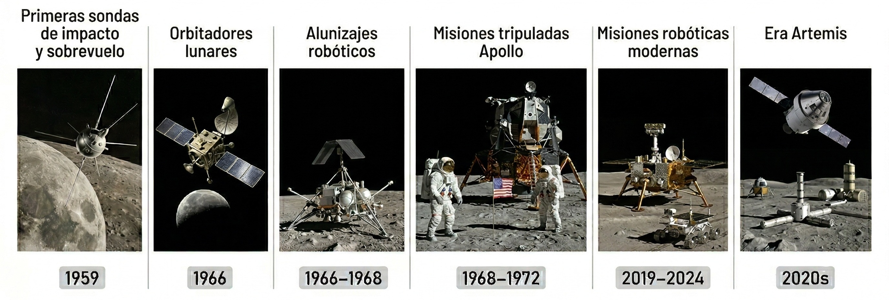
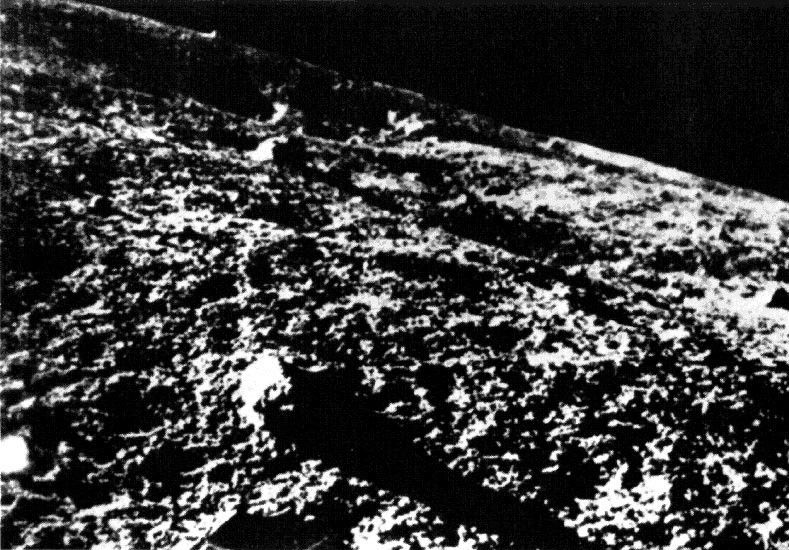
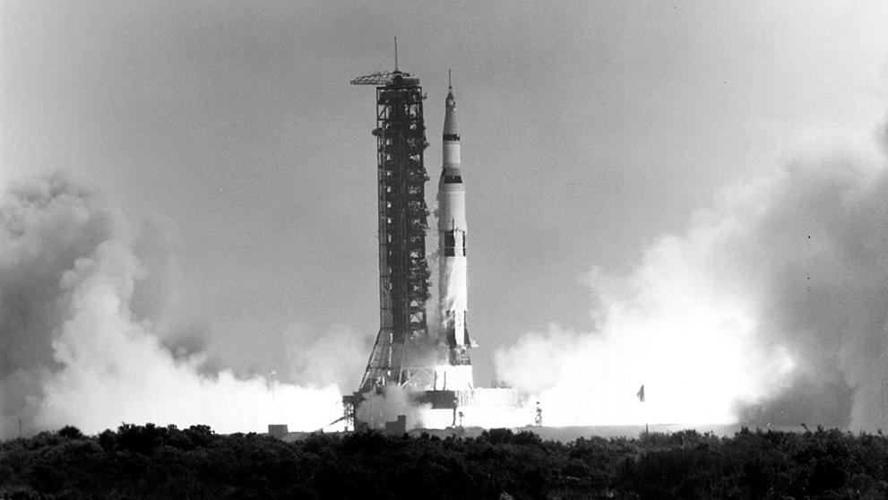
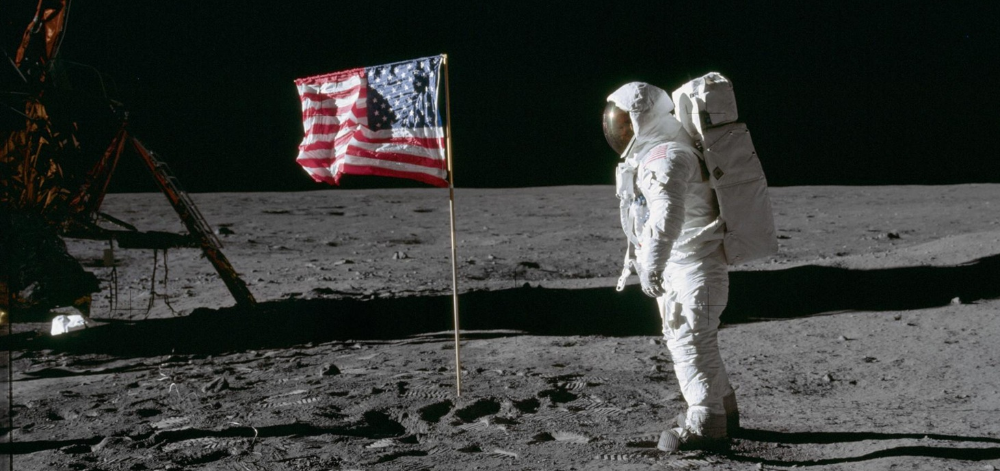
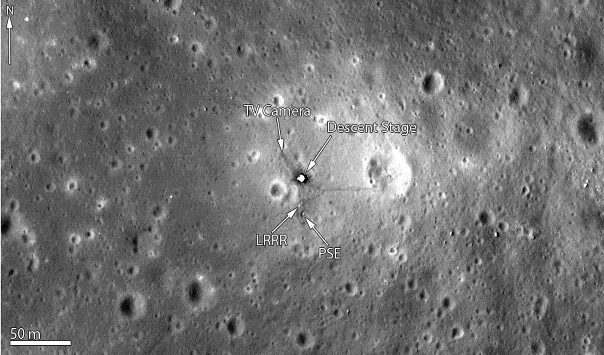
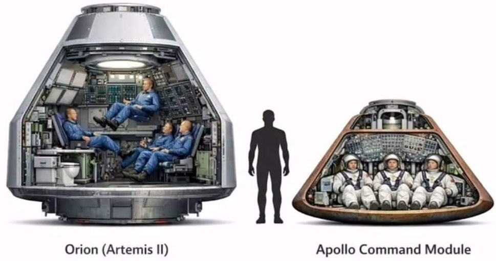

*Texto original: 11/04/2026. Actualización: 23/11/2026 (revisión editorial y estructura).*

El lanzamiento de [Artemis II](https://www.nasa.gov/mission/artemis-ii/) volvió a poner los viajes a la Luna en el centro de la conversación, tanto entre quienes siguen la exploración espacial como entre personas que apenas conocían el tema. También reaparecieron las teorías conspiranoicas sobre Apollo, a veces defendidas con una convicción que haría parecer más verosímil la película [Viaje a la Luna](https://es.wikipedia.org/wiki/Viaje_a_la_Luna), de 1902, que décadas de información acumulada por la [NASA](https://www.nasa.gov/) y otras agencias.

La llegada a la Luna tuvo detrás muchos años de trabajo, pruebas y misiones previas. La exploración lunar avanzó por etapas, primero con misiones que sobrevolaron la Luna o impactaron contra su superficie, luego con orbitadores y alunizajes automáticos que prepararon el terreno para las misiones tripuladas. Algunos recuentos reúnen alrededor de 144 misiones lunares, entre exitosas, fallidas y parcialmente exitosas, con Estados Unidos y la Unión Soviética como protagonistas del primer gran ciclo y con programas de China, India, Japón, Corea del Sur y otros países incorporándose en las últimas décadas.

El programa Apollo incluyó nueve vuelos lunares tripulados y seis alunizajes exitosos. [Apollo 8](https://www.nasa.gov/specials/apollo50th/missions.html) fue la primera misión tripulada en orbitar la Luna, Apollo 10 ensayó el descenso, Apollo 13 sufrió un accidente que impidió el alunizaje, aunque logró regresar a la Tierra, y las misiones posteriores ampliaron las posibilidades de exploración en superficie. El rover lunar que muchos asocian con Apollo 11, por ejemplo, recién apareció en [Apollo 15](https://www.nasa.gov/mission/apollo-15/).

El nombre [Apollo](https://www.rmg.co.uk/stories/space-astronomy/why-was-apollo-called-apollo-history-spacecraft-call-signs) seguía la costumbre de tomar referencias de la mitología clásica. Apolo era una figura compartida por las tradiciones griega y romana, y cuando las misiones comenzaron a utilizar por separado el módulo de mando y el módulo lunar, las tripulaciones también eligieron nombres propios para cada nave. En Apollo 11 fueron *Columbia* y *Eagle*, respectivamente.

En Estados Unidos, antes de Apollo estuvieron [Ranger](https://en.wikipedia.org/wiki/Ranger_program), [Surveyor](https://en.wikipedia.org/wiki/Surveyor_program) y [Lunar Orbiter](https://en.wikipedia.org/wiki/Lunar_Orbiter_program); después llegaron misiones como [LRO](https://science.nasa.gov/mission/lro/), mientras que el programa actual es [Artemis](https://www.nasa.gov/artemis/). Otros países siguieron sus propios recorridos, desde el programa soviético [Luna](https://en.wikipedia.org/wiki/Luna_programme) hasta [Chang’e](https://en.wikipedia.org/wiki/Chinese_Lunar_Exploration_Program), [Chandrayaan](https://en.wikipedia.org/wiki/Chandrayaan_programme) y [SLIM](https://en.wikipedia.org/wiki/Smart_Lander_for_Investigating_Moon). La exploración de la Luna continuó mucho después de 1969.

## La carrera lunar en plena Guerra Fría

Apollo 11 suele quedar reducido en la memoria popular a una transmisión de televisión, unas fotografías y la bandera estadounidense sobre la superficie lunar, pero la misión formaba parte de una competencia tecnológica, política y militar entre dos superpotencias. En plena Guerra Fría, llegar a la Luna tenía un valor estratégico y propagandístico enorme.

La Unión Soviética había acumulado logros importantes con sondas no tripuladas: [Luna 2](https://es.wikipedia.org/wiki/Luna_2) fue el primer objeto construido por el ser humano en impactar la Luna, en 1959; [Luna 9](https://es.wikipedia.org/wiki/Luna_9) consiguió el primer alunizaje suave, en 1966, y [Luna 10](https://es.wikipedia.org/wiki/Luna_10) se convirtió ese mismo año en el primer orbitador lunar.

[Luna 9](https://www.clarin.com/viste/cumplen-55-anos-primer-aterrizaje-controlado-luna_0_WmsfMKf0I.amp.html) envió además las primeras fotografías tomadas desde la superficie. Sus señales fueron captadas por el observatorio británico Jodrell Bank, que consiguió reconstruir y publicar imágenes antes de que Moscú las difundiera oficialmente. La recepción de esas transmisiones por observatorios de otros países recuerda que las misiones espaciales podían seguirse y medirse desde fuera de la agencia responsable del lanzamiento.

*Primera imagen tomada desde la superficie lunar por Luna 9, en febrero de 1966. La misión soviética logró el primer alunizaje suave y transmitió fotografías desde la Luna.*

[Neil deGrasse Tyson](https://es.wikipedia.org/wiki/Neil_deGrasse_Tyson) suele recordar el peso que tuvo la competencia geopolítica para sostener un programa tan costoso como Apollo. El interés científico estaba presente, pero la rivalidad con la Unión Soviética ayudó a movilizar recursos y voluntades políticas a una escala que difícilmente se habría alcanzado de otra manera.

## La Unión Soviética también seguía a Apollo

La URSS era el principal rival de Estados Unidos en la carrera espacial, disponía de capacidad técnica para seguir las misiones y tenía un interés político evidente en desacreditar cualquier triunfo propagandístico estadounidense. Una inconsistencia grave en las trayectorias, las comunicaciones o la propia llegada a la Luna habría sido una oportunidad extraordinaria para Moscú. La hipótesis de un montaje exige aceptar que ese rival, capaz de comprobar buena parte de lo que ocurría, guardó silencio durante décadas.

También habría que explicar cómo se mantuvo un engaño de esa escala entre unas 400.000 personas que trabajaron para NASA, contratistas y empresas vinculadas al programa. Apollo involucró a muchas tripulaciones, técnicos, ingenieros y personal de apoyo durante años, de modo que la conspiración tendría que abarcar mucho más que una filmación y un puñado de funcionarios.

## La bandera, las fotografías y la radiación

Una de las objeciones más repetidas es la bandera que parece flamear en las imágenes de Apollo 11. La bandera llevaba una barra horizontal para mantener la tela extendida y, al manipular el mástil, los astronautas le transmitieron movimiento. Como en la Luna prácticamente no hay atmósfera, ese movimiento no se amortigua por la resistencia del aire como ocurriría en la Tierra. Los pliegues de la tela y las oscilaciones después de colocarla explican lo que se ve en las grabaciones.

En las fotografías tampoco se ven estrellas, algo esperable por la exposición elegida para registrar una superficie iluminada directamente por el Sol y los trajes blancos de los astronautas. Las estrellas son demasiado débiles para aparecer con esos ajustes de cámara.

Las sombras que parecen ir en distintas direcciones se explican por la perspectiva, las irregularidades del terreno y la forma en que la cámara proyecta una escena tridimensional en una imagen plana. Una fotografía puede resultar engañosa si se la analiza como si el terreno fuera perfectamente horizontal y todos los objetos estuvieran a la misma distancia.

Los cinturones de Van Allen son otro argumento habitual. La radiación representaba un riesgo real que se estudió y se tuvo en cuenta al diseñar las trayectorias, procurando atravesar las regiones más intensas en un tiempo limitado y reducir la exposición de la tripulación. El riesgo existía y necesitaba medidas concretas, pero atravesar esos cinturones era técnicamente posible.

También se pide a veces una fotografía del módulo lunar tomada con un telescopio desde la Tierra, aunque el tamaño del módulo y la enorme distancia lunar impiden resolverlo con los telescopios terrestres comunes, incluso con equipos mucho más modernos que los de 1969. Las imágenes detalladas de los lugares de alunizaje proceden de sondas en órbita lunar, que observan la superficie desde mucho más cerca.

## Artemis y el regreso a la Luna

El programa Artemis permite comparar lo que hizo Apollo con los desafíos de volver a operar alrededor de la Luna utilizando sistemas actuales. Pasó más de medio siglo y cambiaron los materiales, las computadoras, la navegación, las comunicaciones y los criterios de seguridad, por lo que cada componente y procedimiento necesita nuevas pruebas y validaciones.

[Artemis I](https://www.nasa.gov/reference/artemis-i-mission-timeline/) fue el primer ensayo integrado de los grandes sistemas del programa, [Artemis II](https://www.nasa.gov/mission/artemis-ii/) llevó nuevamente una tripulación alrededor de la Luna y [Artemis III](https://www.nasa.gov/mission/artemis-iii/) quedó planteada como el siguiente paso en la integración de Orion con vehículos comerciales, necesaria para futuras operaciones en superficie. El programa requiere coordinar lanzadores, naves tripuladas, módulos, plataformas orbitales y sistemas de descenso que pertenecen a otra generación tecnológica, construida a partir de la experiencia de Apollo y de décadas de exploración espacial.

Para seguir las misiones y ver material de la agencia, [NASA+ en español](https://plus.nasa.gov/topics/espanol/) reúne videos y contenidos sobre exploración espacial.
