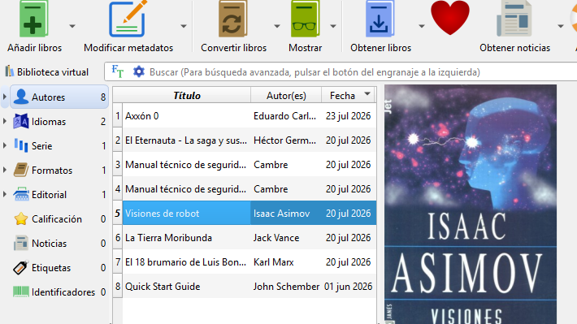

*Texto original: 23/07/2026. Actualización: 23/11/2026 (revisión editorial y estructura).*

Antes del streaming y las suscripciones para todo, los "internautas" descargábamos cuanta cosa aparecía por ahí, convencidos de que algún día nos iba a servir. En mi caso, la mayoría terminó sirviendo de poco 😅, pero dejó una colección de libros, historietas, manuales y material multimedia que todavía conservo en OneDrive, acumulada durante años desde fuentes muy distintas.

La colección nunca fue un caos absoluto, aunque había nombres inconsistentes, carpetas innecesarias, formatos antiguos y archivos que ya no se abrían bien. Revisarla a mano no parecía realista: **58.667 archivos en 2.558 carpetas**. Con la aplicación de escritorio de ChatGPT pude darle a Codex acceso a la carpeta local `Documentos\Libros` y le pedí que mirara qué había ahí.

## Mirar antes de tocar

Codex recorrió las carpetas, revisó extensiones, nombres y contenidos, y preparó un inventario. Yo definía los objetivos y los criterios; la herramienta inspeccionaba los archivos, proponía cambios, escribía los scripts y ejecutaba las tareas, deteniéndose cuando necesitaba autorización o encontraba algo dudoso.

Antes de mover o convertir nada (léase: antes de cagarla), le pedí una simulación. El registro, guardado en CSV, mostraba qué carpetas eliminaría, qué nombres cambiaría y cuáles eran los archivos candidatos a conversión. Recién después de revisarlo autorizaba los cambios reales.

## Poner orden

Codex empezó unificando títulos, numeraciones y nombres de volúmenes. También eliminó carpetas vacías y corrigió estructuras innecesariamente profundas. En algunos cómics, por ejemplo, la carpeta principal contenía otra carpeta y recién dentro de ella estaban las imágenes de las páginas. Codex detectaba esos casos y subía las imágenes al nivel correcto cuando no había otros archivos que justificaran esa separación.

Algo sencillo de corregir en una carpeta se vuelve una tarea interminable cuando se repite cientos de veces. Ya había probado herramientas más tradicionales, pero terminaba escribiendo reglas rígidas para casos puntuales.

## Modernizar formatos antiguos

Después aparecieron documentos DOC y presentaciones PPT. Codex me pidió autorización para usar las aplicaciones instaladas en la computadora y automatizó la conversión a DOCX y PPTX.

Con Office abría cada archivo, generaba la versión nueva y comprobaba el texto, las fuentes y el paginado. Los originales quedaban respaldados antes de reemplazarlos.

También convirtió imágenes BMP a PNG conservando sus dimensiones, recuperó archivos MHT y revisó varios contenidos Flash. Con uno de ellos empezó a buscar una forma de recuperarlo. Al inspeccionar el resto de la carpeta encontró una versión HTML interactiva del mismo material, así que decidí abandonar la conversión y conservar la alternativa que ya funcionaba.

## Atacando los videos y una pausa

Codex encontró también varios videos AVI. Inspeccionó su duración y resolución, descargó FFmpeg, preparó la conversión y generó las versiones MP4. Después comparó los datos de entrada y salida para comprobar que cada archivo conservara la duración y las dimensiones del original. Que hubiera descargado por su cuenta la herramienta que necesitaba fue lo que realmente me sorprendió.

Mi parte fue autorizar el proceso y abrir algunos resultados para revisar imagen y sonido. Con la excusa de comprobar uno, terminé viendo casi un capítulo completo de *Robotech* 🤫.

## De HTML a EPUB

Entre los HTML había cosas muy diferentes. Algunos eran índices, manuales o pequeños sitios que tenía sentido conservar como páginas. Otros contenían obras literarias completas repartidas en varios archivos, con capítulos, imágenes y enlaces internos.

Para esas obras, Codex reconstruyó el orden de los capítulos, generó el índice, reunió las imágenes y armó un EPUB. El resultado se podía abrir y recorrer desde cualquier lector compatible.

Al revisar uno de los EPUB noté que faltaba la portada. No sé si Codex no la había identificado o si nunca habíamos hablado del tema, así que asumí mi rol de liderazgo y le dije:

> Ponele la portada.

Buscó entre los recursos de la obra, encontró la imagen correspondiente y la incorporó. No tuve que señalarle el nombre del archivo ni explicarle dónde estaba.

## EPUB o PDF

Las obras narrativas y los textos divididos en capítulos pasaron a EPUB. Ese formato permite adaptar el texto a la pantalla, cambiar la tipografía y recorrer el contenido mediante un índice.

Los artículos, documentos técnicos y materiales donde importaba conservar la disposición visual terminaron en PDF. En algunos casos también hubo que corregir fondos, márgenes o tipografías para que se leyeran mejor. Los HTML originales y sus recursos también quedaron guardados.

## Cómo terminó la cosa

El trabajo llevó un par de tardes, durante las cuales podía dedicarme a otras cosas y volver cuando Codex terminaba una etapa o necesitaba consultarme algo.

El proceso tuvo errores. Según el registro, PowerShell rechazó la combinación de parámetros del primer script antes de que llegara a ejecutarse, así que Codex lo corrigió y volvió a simular la tarea. También aparecieron reglas que servían para una carpeta pero no para otra y conversiones que necesitaron más de un intento. Ante las dudas, conservaba los originales y dejaba esos casos pendientes.

Hoy probablemente lo haría por etapas más chicas, empezando por un solo tipo de archivo y ajustando las reglas antes de escalar al resto. Aun así, creo que el trabajo quedó hecho en una fracción del tiempo que me habría llevado hacerlo a mano.

Codex tampoco tenía uso ilimitado en mi plan. Pagaba la suscripción Plus, veinte dólares por mes, y unos días después de terminar con la biblioteca, mientras probaba con otras carpetas, me quedé sin cuota. La aplicación indicaba que se restablecería una semana más tarde; podía esperar, comprar créditos, pasar al plan Pro o usar uno de los reinicios que tenía guardados sin saberlo.

Recién ahí me puse a mirar los límites. Solía usar razonamiento alto en ChatGPT Classic sin alcanzarlos y había supuesto que en Codex sería parecido. En mi experiencia, una tarea que recorre miles de archivos y mantiene mucho contexto consume recursos de otra escala; influyen el volumen de información, el modelo y la complejidad y duración del trabajo. El límite apareció bastante antes de lo que esperaba.

¿Fue útil organizar una colección que casi no uso? No lo sé. Pero esas dos tardes me sirvieron para descubrir una aplicación práctica de Codex que no conocía 🤓.
