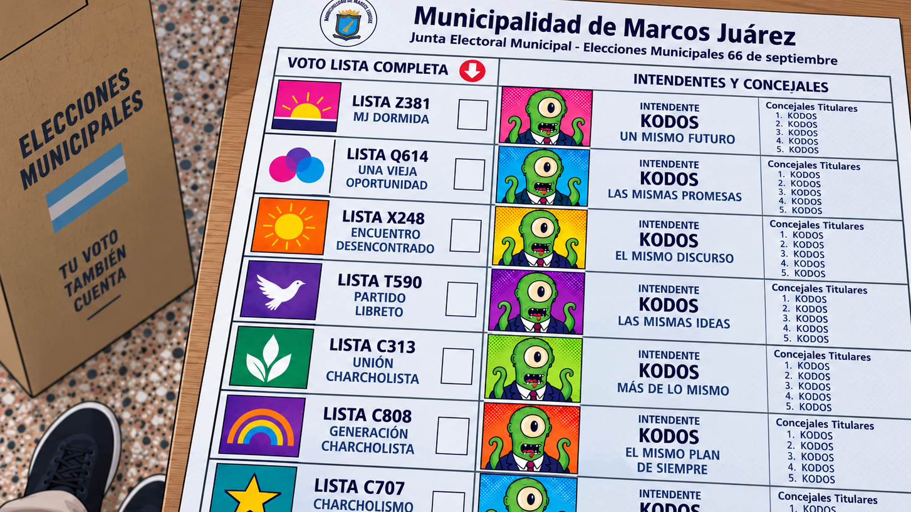

*Texto original: 20/09/2026. Revisado el 19/10/2026, con el diario del lunes.*

Durante mucho tiempo, los partidos políticos sirvieron como una referencia bastante concreta para saber lo que uno votaba. El nombre no explicaba todo, pero permitía reconocer una historia, ciertas ideas y los dirigentes con los que un candidato estaba dispuesto a gobernar.

En las municipales de Marcos Juárez de 2026 se presentaron siete listas y varias de las marcas que habían ordenado la política local durante los últimos años prácticamente desaparecieron de la boleta. Durante la campaña se insistió en que era una elección municipal, que había que hablar de la ciudad y dejar en segundo plano las disputas nacionales o provinciales.

La elección de 2014 también era municipal, pero entonces el PRO la convirtió abiertamente en una vidriera nacional. Mauricio Macri vino a apoyar la alianza con la UCR y, cuando ganó, aquel resultado fue presentado hasta el cansancio como el “kilómetro cero” de Cambiemos. Por entonces mostrar la marca servía; doce años después, varios de esos sellos se convirtieron en una incomodidad.

<figure>
  
  <figcaption>Contraste: cartelera nueva para candidatos, carteles rotos en la obra pública.</figcaption>
</figure>

## Cuando la marca ocupa el lugar de la idea

El marketing político no apareció ayer. Identificar públicos, ver qué atributos suman o restan y decidir cuáles conviene mostrar forma parte de cualquier campaña. Es lógico que un candidato busque comunicar sus propuestas, pero cuando todo se organiza alrededor de su venta, las ideas empiezan a quedar de costado.

En los supermercados una misma mezcla puede venderse como harina leudante o preparado para panes, y un fabricante también puede ofrecer prácticamente el mismo producto bajo distintas etiquetas, incluidas las marcas blancas. Cambian el paquete y aquello que se destaca, aunque el contenido sea casi el mismo.

En política, la pertenencia partidaria, los apoyos o la trayectoria pueden sumar frente a un público y resultar incómodos frente a otro. El candidato sigue siendo el mismo, aunque cambie lo que se pone en primer plano. Cuando esa lógica ordena la campaña, las ideas quedan reducidas a un adorno más en la caja, algo que se muestra si ayuda a vender y se corre cuando molesta. El marketing empezó ayudando a vender ideas y termina muy frecuentemente reemplazándolas por candidatos.

Generación MJ llegó a la elección con nombre e identidad propios. Su candidato reconocía el vínculo con el cordobesismo, pero presentaba el armado como un proyecto local y decía que a la gente no le interesaba tanto de qué partido eran, sino que le resolvieran los problemas. El sello del PJ no aparecía en la boleta, aunque en la lista y alrededor de la candidatura había dirigentes y militantes conocidos del justicialismo de Marcos Juárez.

Después del triunfo, el candidato electo reconoció que la base del espacio era el Partido Justicialista y, semanas más tarde, habló del papel que había tenido el partido, de haber conseguido un candidato propio y de un equipo integrado en gran parte por personas del PJ local.

Algo parecido ocurrió con quien había empezado en el vecinalismo, pasado al PRO y luego fue ministro en el gobierno del cordobesismo. Uno de los protagonistas del tan repetido “kilómetro cero” quiso volver a competir con el PRO, pero cuando no consiguió ese respaldo lanzó un frente local y habló de identidad propia y de decidir sin condicionamientos nacionales. Hacia el final de la campaña reaparecieron los apoyos de Luis Juez, Mauricio Macri y Patricia Bullrich, después de haber insistido durante buena parte de ella en el carácter local de su candidatura.

La pertenencia a esos partidos no era un dato oculto, y el periodismo local la conocía y la mencionó durante la campaña, pero pocas veces cuestionó ese relato con el candidato enfrente. La insistencia en presentar las candidaturas como construcciones estrictamente locales chocaba con sus trayectorias políticas. Como decía Sandoval, uno puede cambiar muchas cosas, pero no de pasión, Benjamín.

## Los que dejan de comprar

En 2026 votó el 64,15% del padrón de Marcos Juárez, frente al 69,01% de 2022. El ausentismo tiene muchas causas y sería demasiado lineal atribuir esa caída al marketing político, aunque cuesta separar por completo la apatía de una política que cambia constantemente de nombres, alianzas y pertenencias.

Al votante se le pide que se interese, participe y valore las instituciones mientras observa cómo una parte de la dirigencia acomoda su identidad según las posibilidades de cada elección, me suena aquello de “Estos son mis principios, y si no le gustan, tengo otros”. Quizás quienes aparecen en la boleta deberían preguntarse cuánto tienen que ver ellos con la apatía, el desencanto y la decisión de tantos ciudadanos de no ir a votar.

---

### Fuentes y entrevistas

Yo no me inventé (todo) esto. Buena parte está en las notas y entrevistas que siguen. Aprovechen a leerlas, no vaya a ser que algún «patriarca» le pida a un medio local que la baje.

- [Clarín (2014): Macri y Aguad en la campaña de Marcos Juárez](https://www.clarin.com/politica/Marcos-Juarez-Macri-Aguad-volvieron_0_HyveiC59PXe.html).
- [Red Panorama (10/07/2026): presentación de Generación MJ y declaraciones sobre su identidad local](https://redpanorama.com.ar/generacion-mj-entra-en-escena-y-competira-por-la-intendencia/).
- [Tiempo Argentino (2026): entrevista al intendente electo sobre la base justicialista de Generación MJ](https://www.tiempoar.com.ar/ta_article/german-font-venimos-del-pj-pero-ampliamos-sin-preguntar-la-identidad-politica/).
- [Nuevo Día (17/10/2026): entrevista sobre el papel del PJ local y la integración del equipo](https://nuevodialeones.com.ar/german-font-sus-prioridades-para-gobernar-marcos-juarez/).
- [Letra P (2026): el intento de Dellarossa de competir con el PRO](https://www.letrap.com.ar/politica/marcos-juarez-dellarossa-se-pega-la-marca-pro-y-acelera-quedarse-el-sello-rumbo-las-urnas-n5421999).
- [Red Panorama (2026): presentación de Marcos Juárez Puede como espacio de identidad propia](https://redpanorama.com.ar/pedro-dellarossa-queremos-tener-una-identidad-propia-y-ser-participes-de-nuestras-propias-decisiones/).
- [Letra P (31/08/2026): cierre de campaña con Juez y mensajes de Macri y Bullrich](https://www.letrap.com.ar/region-centro/elecciones-marcos-juarez-dellarossa-volvio-al-plan-2014-y-cerro-la-campana-juez-macri-y-bullrich-n5426206).
- [Radio Centro (07/09/2026): escrutinio y participación electoral de 2026 y 2022](https://radiocentromj.com.ar/2026/09/07/generacion-mj-gano-la-intendencia-de-marcos-juarez-con-el-4609-de-los-votos/).

