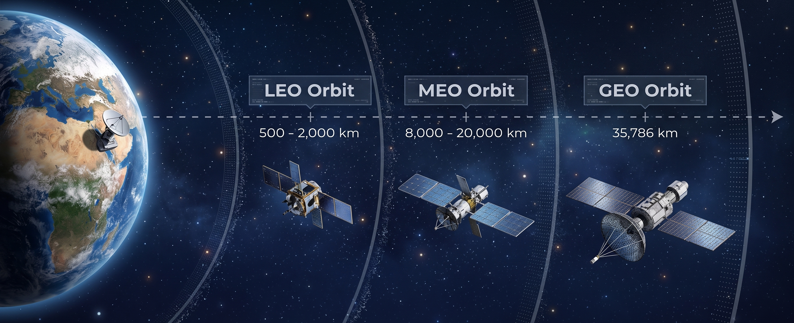
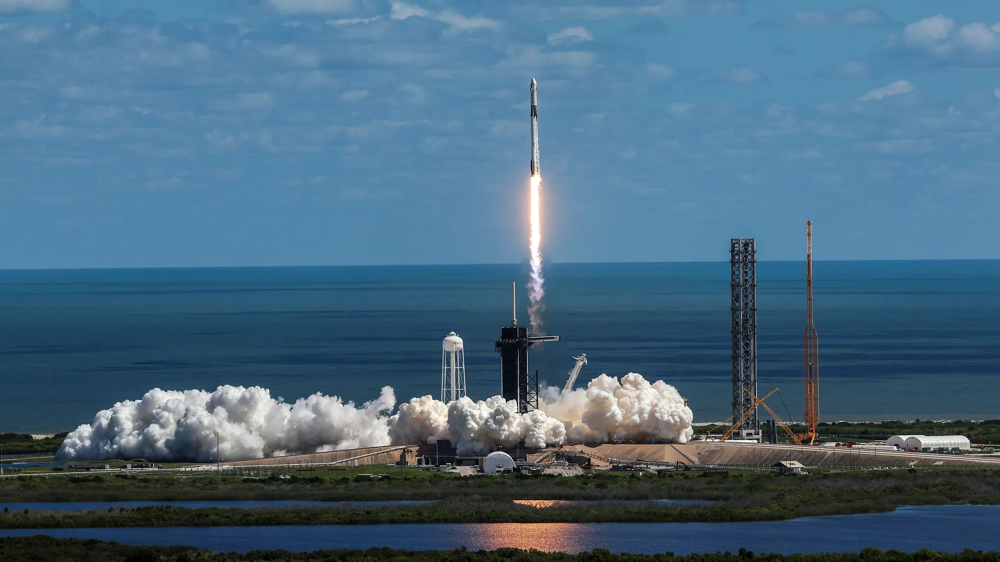
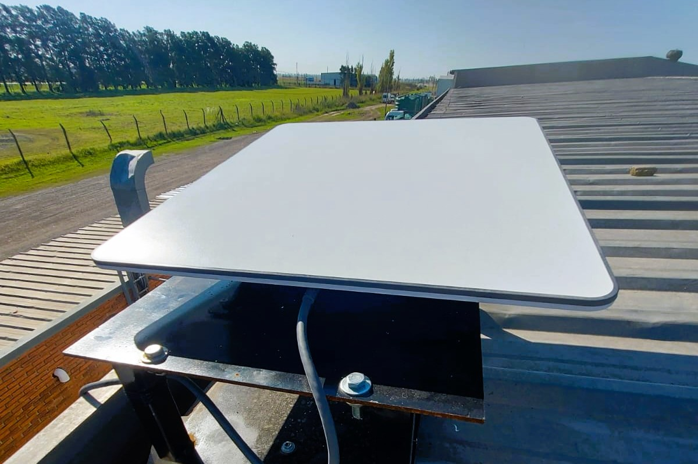

*Texto original: 17/05/2026. Actualización: 23/11/2026 (revisión editorial y estructura).*

Durante años, internet satelital fue una alternativa para lugares sin fibra, radioenlace ni cobertura celular decente: el campo, una escuela rural o una empresa alejada de las ciudades. Permitía conectarse, aunque la latencia y las limitaciones del servicio se notaban bastante frente a una conexión terrestre.

Starlink cambió esa experiencia con una constelación de satélites en órbita baja y antenas capaces de cambiar de enlace mientras los satélites se desplazan. Detrás hay miles de equipos en órbita, estaciones terrenas y una infraestructura de lanzamientos que permite sostener y renovar la red.

## Tecnologías distintas bajo el mismo cielo

Desde tierra, una antena de DirecTV, una de internet satelital clásico y una Starlink pueden parecer variantes de lo mismo. Pero cumplen funciones distintas. La televisión satelital distribuye una señal a una zona amplia y tolera bien la demora de transmisión. GPS usa satélites para ofrecer posicionamiento y tiempo. Los teléfonos satelitales priorizan la comunicación en lugares remotos. En una conexión de internet, en cambio, importa mucho el tiempo de respuesta: abrir una página, hacer una videollamada o conectarse por VPN implica enviar datos y esperar una respuesta.

En los servicios geoestacionarios tradicionales esa demora viene, en buena parte, de la distancia. Starlink utiliza satélites mucho más cercanos a la Tierra para reducirla.

## El satélite como parte de una red

La señal que recibe una antena tiene que llegar, en algún momento, a la infraestructura terrestre de internet. Un satélite de comunicaciones actúa como un nodo que transporta datos entre puntos de esa red.

En un sistema satelital tradicional, el recorrido básico suele ser:

**usuario → antena → satélite → estación terrena → red terrestre → internet**

Con enlaces láser entre satélites, Starlink puede agregar un tramo espacial antes de bajar la señal:

**usuario → antena → satélite → enlace láser con otro satélite → estación terrena → internet**

Ese segundo camino permite elegir otros puntos de salida, aunque la conexión sigue dependiendo de estaciones terrenas y redes de fibra.

## La altura cambia la conexión

Los satélites **geoestacionarios** están a unos **35.786 kilómetros** sobre el ecuador. A esa altura acompañan la rotación de la Tierra y, vistos desde el suelo, parecen fijos. Por eso una antena de DirecTV se orienta hacia un punto y puede quedarse allí. Para recibir televisión funciona muy bien; para aplicaciones interactivas, el viaje de ida y vuelta de la señal agrega una latencia inevitable.

[ARSAT ofrece cobertura satelital geoestacionaria con ARSAT-1 y ARSAT-2](https://www.arsat.com.ar/satelites-geoestacionarios-de-telecomunicaciones/) en Argentina y el continente americano. ARSAT-2 ocupa la posición orbital **81° Oeste**. Este tipo de infraestructura tiene sentido para cobertura amplia, distribución de contenidos y enlaces de datos en zonas donde otras redes no llegan. Su función y su arquitectura son diferentes de las de Starlink.

| Sistema | Altura aproximada |
|---|---:|
| Avión comercial | 10 a 12 km |
| Starlink / LEO | alrededor de 550 km |
| GPS | alrededor de 20.200 km |
| GEO / ARSAT / DirecTV / satelital clásico | alrededor de 35.786 km |

*Comparación de órbitas: LEO (baja), MEO (media, GPS) y GEO (geoestacionaria). La distancia real entre LEO y GEO es mucho mayor de lo que suele sugerir un diagrama simple.*

[Starlink describe su constelación como una red de órbita baja](https://www.starlink.com/technology), con satélites alrededor de los 550 km. GPS opera en órbita media, cerca de los 20.200 km; [GPS.gov](https://www.gps.gov/systems/gps/space/) explica que sus satélites completan dos vueltas a la Tierra por día.

Un satélite LEO reduce la distancia que recorre la señal, pero cubre menos superficie y se desplaza respecto del usuario. Para prestar servicio continuo hacen falta muchos satélites y cambios de enlace que la antena pueda resolver sin interrumpir la conexión. Se puede ver ese movimiento en [satellitemap.space](https://satellitemap.space/), [N2YO](https://www.n2yo.com/), [Heavens-Above](https://www.heavens-above.com/) o [starlink.sx](https://starlink.sx/).

## Cómo sostiene Starlink una conexión continua

La antena del usuario utiliza una matriz de fase, o *phased array*, para orientar electrónicamente el haz dentro de su campo de visión. Puede permanecer físicamente quieta mientras cambia de satélite y de ruta hacia una estación terrena u otro satélite. El usuario instala la antena y, detrás de esa operación aparentemente simple, la red decide qué enlace utilizar y cuándo pasar al siguiente.

La cantidad de satélites también exige una logística poco habitual en telecomunicaciones. Tienen una vida útil limitada y hay que reponerlos, incorporar nuevas generaciones y ampliar capacidad. Ahí aparece la ventaja de que Starlink pertenezca a **SpaceX**: la empresa fabrica y opera la constelación, y cuenta con Falcon 9 para realizar lanzamientos frecuentes. Starship forma parte de sus planes de desarrollo, aunque el despliegue descripto aquí se apoya en Falcon 9.

*Lanzamiento de Falcon 9. La frecuencia de lanzamientos permite desplegar y reponer satélites de una constelación que necesita renovarse continuamente.*

## Donde la señal vuelve a tierra

Las **estaciones terrenas**, o *gateways*, conectan los satélites con las redes terrestres. Son instalaciones con antenas y enlaces a fibra, proveedores y centros de intercambio de tráfico. Los enlaces láser permiten que parte de los datos viaje entre satélites antes de llegar a una de esas estaciones.

[Starlink publica información sobre sus puntos de presencia](https://www.starlink.com/support/article/45d1d256-171e-0f67-4895-5d248fa63b66); para Argentina menciona Buenos Aires. También circularon referencias a posibles gateways o instalaciones asociadas en Chivilcoy, Campana, La Plata, Salta y Río Negro. Ese listado requiere verificación y conviene distinguirlo de un inventario oficial de instalaciones operativas.

Esto explica por qué Starlink resulta tan útil en el último tramo de conexión: puede llevar servicio a un lugar donde no existe una red terrestre cercana, aunque por detrás siga utilizando infraestructura física para llegar al resto de internet.

## Antenas, orientación y clima

En una instalación fija, la aplicación indica qué sector del cielo conviene despejar y hacia dónde orientar la antena. En nuestra zona suele pedir orientación hacia el sur. Desde Argentina, los satélites geoestacionarios se ven hacia el norte, y Starlink tiene que convivir con esos sistemas. La selección de enlaces depende también de la elevación, las obstrucciones, la carga de red, la celda de servicio y las restricciones regulatorias. Por eso importa disponer de una buena ventana de cielo, más que apuntar permanentemente a una dirección.

*Antena Starlink Performance instalada en la planta. Orientación sur, cielo despejado.*

Entre los equipos de usuario hay diferencias de consumo, portabilidad y margen de enlace. La **Standard** sirve para un uso fijo o portátil habitual; la **Mini** prioriza el tamaño y el bajo consumo; la **Performance** está pensada para condiciones más exigentes, como una instalación de producción donde la estabilidad importa.

Starlink trabaja en bandas de alta frecuencia y la lluvia puede atenuar la señal, un fenómeno conocido como *rain fade*. Una lluvia normal puede pasar inadvertida; durante un temporal pueden bajar las velocidades, subir la latencia o aparecer microcortes. Una tormenta intensa puede interrumpir temporalmente el enlace incluso con una antena Performance. Un equipo con mayor margen ayuda en condiciones difíciles, pero también tiene límites.

Las obstrucciones generan otro tipo de problema. Árboles, techos, silos o estructuras metálicas pueden bloquear parte del cielo que la antena necesita. En movimiento se suma el cambio de orientación del vehículo: una antena sobre el techo, con cielo despejado, suele estar en mejores condiciones que una ubicada sobre el torpedo de un camión, detrás del parabrisas y los parantes. Al girar, la antena utiliza los satélites que quedan disponibles dentro de su nueva ventana; si esa geometría empeora, la conexión puede degradarse.

## Cuando el celular se conecta al satélite

[Starlink Direct to Cell](https://www.starlink.com/business/direct-to-cell) plantea que teléfonos LTE convencionales puedan comunicarse directamente con satélites, sin instalar una antena Starlink. La propuesta apunta a cobertura en lugares donde faltan antenas celulares terrestres, con cielo visible y acuerdos con operadores.

En un documento de febrero de 2025, Starlink informó disponibilidad comercial de mensajería satelital en Estados Unidos y Nueva Zelanda, y presentó otros servicios como pasos posteriores. La capacidad y las prestaciones dependen de la etapa de despliegue y del operador. Para un mensaje desde una ruta o un campo aislado, ese enlace puede ser muy valioso; para el tráfico habitual de una ciudad, una red 4G o 5G terrestre ofrece mucha más capacidad. Es un uso diferente del que resuelve una terminal Starlink instalada en un edificio o vehículo.

## La competencia también necesita lanzamientos

Amazon desarrolla otra constelación de órbita baja, antes llamada Project Kuiper y presentada luego como [Amazon Leo](https://www.aboutamazon.com/news/amazon-leo/project-kuiper-becomes-amazon-leo). El proyecto contempla más de **3.000 satélites**, enlaces ópticos y una infraestructura de estaciones terrenas y fibra.

[Amazon anunció en 2023 un contrato por tres lanzamientos Falcon 9 con SpaceX](https://www.aboutamazon.com/news/innovation-at-amazon/amazon-project-kuiper-spacex-launch), para complementar a otros proveedores y reducir riesgos en su calendario. Es un ejemplo concreto de cuánto pesa la capacidad de lanzamiento en este tipo de proyectos, incluso cuando quien necesita los cohetes compite con Starlink.

También están **OneWeb/Eutelsat**, con una orientación más empresarial, gubernamental y de transporte de datos, y las constelaciones que impulsa China. La competencia abarca satélites, espectro, capacidad industrial, lanzadores, estaciones terrenas y acuerdos con operadores.

La fibra sigue siendo la mejor opción cuando está disponible y funciona bien. Pero donde antes una conexión satelital implicaba aceptar grandes demoras, Starlink permite trabajar por VPN, hacer videollamadas, operar una planta o tener un enlace de respaldo con una experiencia mucho más cercana a la de una red terrestre. Siguen contando el clima, los obstáculos y la capacidad disponible, especialmente en los lugares donde esa antena termina siendo la única conexión razonable.
